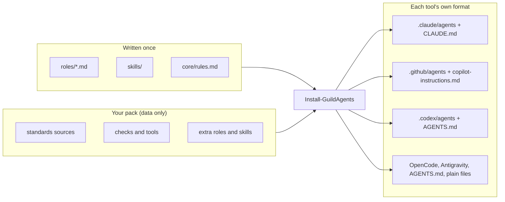

# Guild

[](https://github.com/spross216/Guild/actions/workflows/ci.yml)


**Portable, governed agent roles for any AI coding tool.** Write a team of agents once (an architect,
a builder, a reviewer, a steward) and install it into Claude Code, GitHub Copilot, OpenAI Codex,
OpenCode, Antigravity or anything that reads `AGENTS.md`. Your organization's standards, checks and
extra roles plug in as data, so the roles themselves never change.

> AI interprets ambiguity; software enforces invariants; humans grant authority.

## Why

AI coding agents are only as consistent as their instructions, and every tool wants those
instructions in a different format. Teams end up with prompts copied between tools, standards
restated in each one, and agents that approve their own work. Guild separates the parts:

| Concern | Where it lives |
|---|---|
| How each role behaves | Tool-neutral Markdown roles, written once |
| What your organization requires | A **pack**: a data-only `.psd1` pointing at your standards, checks and extra roles |
| How each tool wants it | An adapter per tool; adding a tool is one data file |
| What must be true, not just asked for | Deterministic commands and guards: checks, context, doc drift, read-only enforcement |
| What only people decide | Commits, pushes, deploys, accepting a standard. Agents never do these. |

## Quick start

Requires PowerShell 7.2+ and git; the read-only guard assumes PowerShell 7.3 or later argument passing
for native commands.

```powershell
git clone https://github.com/spross216/Guild.git
Import-Module ./guild/Guild/Guild.psd1

Get-GuildHarness                                  # supported tools, and which are installed here
Install-GuildAgents -Harness claude -WhatIf       # preview
Install-GuildAgents -Harness claude               # every Claude Code session on this machine
Install-GuildAgents -Harness claude, copilot -Scope Project -Path ./my-app -Pack ./packs/example/example.pack.psd1
Test-GuildInstall -Harness claude                 # anything missing, outdated or edited by hand?
```

Restart Claude Code, then ask for a design or a review in any repository. The routing block Guild
adds to `CLAUDE.md` tells the main session to hand the work to the right agent.

## How it fits together



The same reviewer, rendered from one source with the example pack:

```markdown
---
name: acme-reviewer
description: "Independent read-only reviewer and debugger. ... Use proactively for: reviewing a change
  or pull request, approving work, debugging a failing build, deploy or running system."
tools: Read, Grep, Glob, Bash, PowerShell
model: opus
hooks:
  PreToolUse:
    - matcher: "Bash|PowerShell"
      hooks:
        - type: command
          command: "pwsh ... guards/Test-GuildReadOnlyCommand.ps1 -Allow 'Test-AcmeProject'"
---
...
First verify:
Run `Test-AcmeProject -Path <project>` (first run `Import-Module '.../AcmeChecks.psd1'`). It must pass
before the change is called done.
```

For Copilot, the same body gets `tools: ['read', 'search']`. With no pack, that line reads "No check is
configured. Run the project's own test and lint commands ... If it has none, say plainly that nothing
verified the change."

## The roles

| Role | Job | Access |
|---|---|---|
| `architect` | Designs before anything is built; owns every Mermaid diagram in the docs; writes decision records | Docs: Markdown only |
| `builder` | Writes code and tests, test-first; updates the docs its change touches | Write |
| `reviewer` | Independent review (APPROVE / CHANGES_REQUIRED) and debugging | Read-only |
| `steward` | Keeps standards and checks; keeps prose docs in sync; synthesizes draft standards from named repositories | Write |

Packs add more (the example adds a `security` role). The main session leads; there is no orchestrator
agent. Routing rules: answer questions directly, design first when there is more than one piece, the
author is never the only reviewer, and high-risk work gets independent tests and review at any size.

**Enforced, not just asked:** in Claude Code, read-only roles run behind a hook that blocks shell
commands that change things, and the architect behind one that only allows Markdown edits. Where a
tool has no such hook, Guild says so instead of pretending.

The command guard fails closed: PowerShell is parsed and checked against an allowlist of commands,
parameters and syntax, Bash is limited to a narrow subset, and nothing unlisted runs. It also denies,
on a best-effort basis, reads that print secret values. It covers both the Bash and PowerShell tools
and needs Claude Code 2.1.295 or later, which `Test-GuildInstall` checks. It is a guardrail for
cooperative agents, not a security boundary; the design is in [`docs/guard.md`](docs/guard.md).

## Supported tools

| Tool | Name | Mode | Read-only and docs roles |
|---|---|---|---|
| Claude Code | `claude` | Subagents + skills + routing in `CLAUDE.md` | Tool lists plus command and file-edit hooks |
| GitHub Copilot | `copilot` | Custom agents + skills + routing in `copilot-instructions.md` | Tool lists (no edit or execute for read-only) |
| OpenAI Codex | `codex` | Custom agents (TOML) + routing in `AGENTS.md` | Stated; run the parent session read-only |
| OpenCode | `opencode` | Subagents | Edits denied (read-only) or asked (docs); shell asks |
| Antigravity CLI | `antigravity` | Instructions in `AGENTS.md` / `GEMINI.md` + skills | Stated |
| Anything reading `AGENTS.md` | `agents-md` | Instructions | Stated |
| Anything else | `generic` | Plain role files | Stated |

In instructions mode one agent plays every role in turn, so review is less independent; use a tool
with subagents for high-risk work. Installs are safe: Guild never overwrites a file it didn't write,
won't replace one edited by hand without `-Force`, removes what it no longer produces, keeps your own
content around its managed blocks, and supports `-WhatIf` everywhere.

## Packs

A pack is a `.psd1` read with `Import-PowerShellDataFile`, so loading one never runs code. It holds
pointers and settings, never copied standards text. Packs layer (defaults, then each pack and what it
extends; later wins), paths are relative to the pack, and `Get-GuildPack` validates one and shows the
merged result.

| Key | What it sets |
|---|---|
| `Knowledge` | Standards, decisions, patterns and skills to read, highest precedence first |
| `Languages`, `Style` | Language choices for new work; style guides and the linters that own what they check |
| `Capabilities` | Commands for Scaffold, Describe, Check, Diagnose, Update, Infra, Promote; each unbound one has a sensible fallback |
| `Roles`, `Skills` | Extra roles; extra or replacement skills |
| `RoleAddenda` | Notes appended to a role, or to the main session's routing (`deliver`) |
| `Policy` | What agents must never invent; what is always high risk |
| `Review`, `Models` | Review rounds, findings categories, promotion threshold; model per role and tool |

[`packs/example/`](packs/example) is a complete worked pack for a fictional company. The full contract
is in [`docs/spec.md`](docs/spec.md).

## Commands for the agents

Deterministic steps every role knows how to load, so tasks start and end the same way:

| Command | What it does |
|---|---|
| `Get-GuildContext` | One snapshot to start a task: languages, standards, the check, git state, docs, diagrams, decisions |
| `New-GuildBrief` | A hand-off with the same sections every time, including high-risk requirements |
| `New-GuildDecision` | The next numbered decision record |
| `Test-GuildDocs` | Documentation and diagram drift, each finding routed to the steward or the architect |
| `Get-GuildRepoSurvey` | A factual inventory of a repository: languages, tests, linting, CI, infrastructure, docs |
| `New-GuildStandardsRepo` | A standards repository where synthesized drafts stay out of the pack until a person accepts them |
| `Add-GuildFinding`, `Get-GuildFindingSummary` | A findings log that shows which review findings keep coming back, so they become checks |

## Design

The reasoning is recorded in [`docs/decisions/`](docs/decisions):

- [0001](docs/decisions/0001-portable-roles-and-packs.md) Portable roles, configured by data-only packs
- [0002](docs/decisions/0002-no-orchestrator-agent.md) No orchestrator agent
- [0003](docs/decisions/0003-docs-access-and-documentation-ownership.md) Docs access and documentation ownership
- [0004](docs/decisions/0004-routing-in-always-read-files.md) Routing in the files each tool always reads
- [0005](docs/decisions/0005-fail-closed-read-only-guard.md) A fail-closed read-only guard

The first end-to-end trial, and what to change before larger projects:
[`docs/evaluations/2026-10-first-trial.md`](docs/evaluations/2026-10-first-trial.md).

## Limits

- Guards are guardrails, not a sandbox. They are strongest in Claude Code; elsewhere some rules are
  instructions only, and Guild's tables say which.
- Agent file formats change. Each adapter cites the documentation it follows; report breakage in an
  issue.
- PowerShell is the installer's language; the generated roles are plain Markdown and work anywhere.

## Contributing

See [CONTRIBUTING.md](CONTRIBUTING.md). `./build.ps1` lints and tests; it must pass with no
PSScriptAnalyzer findings and no skipped tests. Changes are listed in [CHANGELOG.md](CHANGELOG.md).

## License

[MIT](LICENSE)
