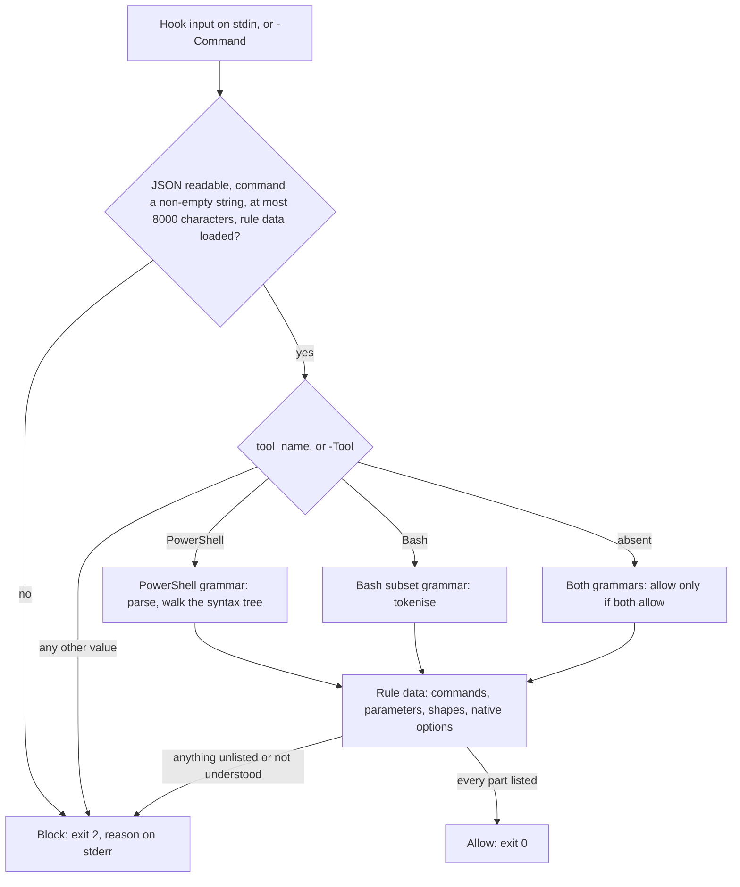

# Read-only command guard: design

**Status:** Accepted, as [decision 0005](decisions/0005-fail-closed-read-only-guard.md) (2026-10-26).
This replaces the internals of `guards/Test-GuildReadOnlyCommand.ps1` and adds its rule data,
`guards/Test-GuildReadOnlyCommand.psd1`. The hook wiring in `Guild/Private/Adapters.ps1` changed
too; see [Hook wiring](#hook-wiring) in §1.

The guard keeps a cooperative agent in a read-only or docs role from changing things by accident. It
is a guardrail, not a security boundary. Decision 0005 states the threat model and the accepted gaps.
The rule is **fail closed**: a command is allowed only when the guard understands every part of it and
every part is on an allowlist.

Terms used below:

- *Block* means exit 2 with a reason on stderr. *Allow* means exit 0.
- *Rule data* is `guards/Test-GuildReadOnlyCommand.psd1`.
- Section numbers such as §3 refer to the sections of this document.

## 1. Contract

| Input | Behaviour |
|---|---|
| Hook (no `-Command`) | Read all of stdin as UTF-8 JSON. The input must be exactly one JSON object. An array, a second value after the object, or a key that appears twice in one object blocks, and so does a key that differs from another only in the case of its letters (`TOOL_INPUT` next to `tool_input`). `tool_input.command` must be a non-blank string. `tool_name`, when present, must be a string; it selects the grammar (§2). A failure to read the input blocks. |
| `-Command <text>` | Judge `<text>` directly. Used by people and by the harness tests. |
| `-Tool Bash` or `-Tool PowerShell` | Optional. With `-Command`, chooses the grammar. Without it, `-Command` behaves as an absent `tool_name`. |
| `-Allow <a,b,c>` | Extra PowerShell commands (§4.11). The installer passes them. |
| Exit codes | 0 allows. 2 blocks, with one line on stderr: `Read-only role: blocked: <reason>. <hint>` |

Every other field of the hook input is ignored, including `run_in_background`, `timeout` and
`description`.

The guard has no batch switch. `tests/GuardBatchRunner.ps1`, a test-only script, dot-sources the guard
(which returns early when dot-sourced, so it defines its functions and runs nothing) and judges a JSON
array of `{ tool_name, command, allow }` in one process.

### Hook wiring

For Claude Code (`Guild/Private/Adapters.ps1`), read-only and docs roles get one PreToolUse hook with
the matcher `Bash|PowerShell`. It runs `pwsh -NoProfile -NonInteractive -File <guard>`, with `-Allow <list>`
when the role has commands to allow.
Each guard hook has `timeout: 30` and `onFailure: block`, so a hook that can't start, exits with a code
other than 0 or 2, or times out blocks the command instead of letting it run. `onFailure` needs Claude
Code 2.1.295 or later ([hooks reference](https://code.claude.com/docs/en/hooks.md)). Docs roles also get
a hook on `Edit|Write|MultiEdit|NotebookEdit` that runs the docs edit guard, `guards/Test-GuildDocsEdit.ps1`.

A `|| exit 2` shell wrapper was rejected: Git Bash and Windows PowerShell 5.1 treat it differently, and
on Windows the hook command runs in Git Bash by default. `Test-GuildInstall` reports each guard script a
hook names, and the read-only guard's rule data file, with Kind `Guard`: Current when the file exists,
Missing when it doesn't. With the `claude` harness it also reads `claude --version` and reports Kind `Claude`:
Current from Claude Code 2.1.295 (where `onFailure: block` was added), Outdated below it (with a warning, since
the hooks' `onFailure` is then ignored), and Unknown when `claude` isn't on the PATH (not a failure).

## 2. Dispatch



*The guard's decision path, implemented in `guards/Test-GuildReadOnlyCommand.ps1` with its rule data
next to it.*

| `tool_name` | What happens |
|---|---|
| `PowerShell` | PowerShell grammar only (§4). |
| `Bash` | Bash grammar only (§5). PowerShell syntax sent through Bash is blocked, with the hint "use the PowerShell tool". In Git Bash, PowerShell commands aren't commands anyway. |
| Absent or null | Both grammars must allow. This is fail-closed: whichever tool runs the text, it's allowed by that tool's grammar. If either blocks, the reason given is the first one, with the grammar named. |
| Any other value, including an empty string or a non-string | Block: "the guard only judges the Bash and PowerShell tools", naming the value when it is a string. |

Other failures:

- **Internal failures block.** The whole script runs inside one `try`. Any exception, or a missing or
  invalid rule data file, blocks with "the guard could not check this command". Strict mode is
  `Latest`, so a missing property or key is an error that blocks, not a silent null.
- **Deep nesting blocks.** Statement and expression nesting deeper than 64 levels blocks with "the
  command is nested too deeply for the guard to check".
- **Commands longer than 8000 characters block.**
- **Control characters block.** Any character below U+0020 other than tab (and, for PowerShell only,
  CR and LF) blocks before parsing.
- **Input that can't be read blocks**, with "the hook input could not be read".

## 3. Rule data

`guards/Test-GuildReadOnlyCommand.psd1` is loaded with `Import-PowerShellDataFile` (data only).
Code holds the walkers and the native-option handlers. The lists live in the data. Top-level keys,
as the file has them:

| Key | Shape | Used by |
|---|---|---|
| `PowerShellCommands` | `Name = @{ Parameters = @{ Name = Shape }; Positional = @(Shape, ...); PositionalRest = Shape; Denied = @{ Name = 'reason' }; RequiresAllow = $bool }`. `Positional`, `PositionalRest`, `Denied` and `RequiresAllow` are optional. | §4.4 and §4.5 |
| `CommonParameters` | `@{ ErrorAction = 'Value'; WarningAction = 'Value'; InformationAction = 'Value'; Verbose = 'Switch' }` | Every PowerShell command |
| `NeverParameters` | Names: `OutVariable`, `ErrorVariable`, `WarningVariable`, `InformationVariable`, `PipelineVariable`, `OutBuffer`, and the short forms `ov`, `ev`, `wv`, `iv`, `pv`, `ob` | Commands passed with `-Allow` (§4.11) |
| `PositionalNames` | `Name = @(@('Param'), ...)`: one entry per positional slot, each an array of the parameter names that can fill that slot. A one-parameter slot is written `@(,@('Param'))`. The rule-data test checks the count, that each name is a listed parameter at that position in some parameter set, and that every listed parameter at a positional slot is named. | §4.5 |
| `UnlistedParameters` | `Name = @{ Param = 'reason' }`: parameters that aren't listed but can still bind (by position, or from a piped property), each with the reason it is harmless | §4.5 and the rule-data tests |
| `ConfiguredObjects` | `pester = @{ Factory = 'New-PesterConfiguration'; Settings = @('Run.Path', ...) }` | §4.9 |
| `StaticMembers` | `'System.Math' = @('Max', ...)` keyed by full type name | §4.7 |
| `InstanceMethods` | Method names | §4.7 |
| `DeniedMembers` | Property names never read: `PSObject`, `PSBase`, `PSAdapted`, `PSExtended`, `ScriptBlock`, `OnRemove` | §4.7 |
| `ConvertTypes` | Full type names allowed in `[type]` conversions and `-as` | §4.6 |
| `ReservedVariables`, `AssignablePreferences` | Names | §4.8 |
| `CloudDeniedVerbs` | Words that mark a change in an `az` or `gcloud` path, such as `create`, `delete` and `deallocate` | §6.4 |
| `SecretPathPatterns` | Regexes for local credential files (`.ssh`, `.aws`, `.azure`, `.kube/config`, `.env`, and others) | §4.14 |
| `SecretPathExceptions` | Regexes for placeholder files that are allowed (`.env.example`, `.env.sample`, `.env.template`, `.env.dist`) | §4.14 |
| `EnvDrivePattern` | Pattern for the Environment drive and provider (`env:`, `Environment::`, `Microsoft.PowerShell.Core\Environment::`), tolerating leading separators and `/` or `\` after `Microsoft.PowerShell.Core`. Captures the remainder, which must be one name. Anchored with `\z` in single-line mode, so a trailing newline can't hide a name | §4.14 |
| `EnvNamePattern` | `^[A-Za-z_][A-Za-z0-9_]*\z`: the one shape an environment name may take (the allowlist). Used for `env:`, `$env:`, `${env:}` and `GetEnvironmentVariable` | §4.14 |
| `EnvProviderFallbackPattern` | `(?i)Environment::|(^|[^A-Za-z0-9])env:`: a word PowerShell can't parse as a provider path is refused when it matches | §4.14 |
| `SecretNamePattern` | Case-insensitive pattern for secret-like names (`TOKEN`, `SECRET`, `KEY`, `PASSWORD`, `PWD`, `CREDENTIAL`, `CONNECTION`, `COOKIE`, `SESSION`, `AUTHORIZATION`, and `PAT`, `AUTH` or `URL` as whole words) | §4.14 |
| `UserVariablePattern` | `^[a-z][A-Za-z0-9_]*$`: the only names a command may assign (the lowercase-first rule), besides the listed preferences | §4.8 |
| `ShortNamePattern` | Old DOS short-form segments (`NAME~1`) after a separator, `/`, `\` or `:`, or at the start of a word followed by a separator. `:` is a leading separator, and the segment ends at the end of the word or at a separator. Refused, because they can reach a credential file under another name | §4.14 |
| `ShortNameBarePattern` | A bare word in short form (`NAME~1`) whose stem contains `-`, `_` or a digit, or is a known credentials stem (`SSH`, `AWS`, `AZURE`, `KUBE`, `DOCKER`, `NETRC`, `NPMRC`, `PYPIRC`, `GNUPG`, `ENV`). Plain-letter revisions such as `HEAD~1` are not matched | §4.14 |
| `SecretSegmentNames` | Credential names that a wildcard's literal prefix can reach (`.ssh`, `.aws`, `.env`, `id_rsa`, `local.settings.json`, and others). A wildcard prefix that begins one of them blocks | §4.14 |
| `SecretGlobProbes` | Names that a wildcard segment with literal text is tested against (for example `.env.local`, `credentials`, `local.settings.json`). A match blocks. `hosts.yml` is not a probe name | §4.14 |
| `SecretReadPatterns` | Names that are secret only when read (`credentials`): a listing may show them | §4.14 |
| `ListingCommands` | Commands that only list names (`Get-ChildItem`, `Get-Item`, `Test-Path`, `Join-Path`, `ls`, `find`, `tree`, `pwd`, `cd`, and others). Their wildcards are judged by the listing rules | §4.14 |
| `GitListingSubcommands` | The git reads that only list (`ls-files`, `ls-tree`, `status`) | §4.14 |
| `FindPatternOptions` | The `find` options whose value is a pattern, not a path (`-name`, `-iname`, `-path`, `-ipath`, `-wholename`, `-regex`, `-iregex`) | §4.14 |
| `PipelineReaders` | The commands that read the files named in their arguments or fed by a pipeline (`Get-Content`, `Select-String`). A listing in the same input is judged as a reader when a reader has no literal path | §4.14 |
| `SearchValueOptions` | The options of `rg`, `grep` and their relatives that take a value, skipped when the search pattern is located (`-A`, `-B`, `-C`, `-m`, `-g`, `-t`, `--glob`, `--include`, `--exclude`, `--ignore-file`, `--type`, and others). Their values are checked as paths or names, not taken as the pattern | §4.14 |
| `SearchToolValueOptions` | Per search tool, the options that take a value only for that tool. Currently `rg`: `--color` (for GNU `grep`, `egrep`, `fgrep` and `git grep`, `--color` is a flag and `--color=WHEN` is the form) | §6.8 |
| `StaticFileReaders` | The `[System.IO.File]` static methods that read the file named by their argument (`ReadAllText`, `ReadAllLines`) | §4.7 |
| `SecretGlobTargets` | Credential paths (`.aws/credentials`, `.kube/config`, `.ssh/id_rsa`, `.config/gh/hosts.yml`, and others) that a wildcard path can match. A match blocks | §4.14 |
| `LeadingWildcardSkip` | Probe names that a leading wildcard is not tested against: only `local.settings.json`, and only for listing commands (`Get-ChildItem *.json`). Bash refuses a leading glob anyway (§5.1) | §4.14 |
| `EnvExampleNames` | Placeholder names that a wildcard may match (`.env.example`, `.env.sample`, `.env.template`, `.env.dist`), the `.env.exam*` exception | §4.14 |
| `NativeCommands` `jq` entry | `FilterDeny` (the filter may not read the environment: `$ENV`, `env`), `Flags` and `ShortFlagChars` (the allowed options), `ValueOptions` and `TwoWordOptions` (options that take a value; the two-word ones are `--arg`, `--argjson`, `--slurpfile`, `--rawfile`, which also check the file) | §6.7 |
| `NativeCommands` `aws` entry: `DeniedWhenWord` | Per operation, a word that refuses the operation: `ec2 describe-instance-attribute` with `userData` (`--attribute userData`, or `--attribute=userData`) | §6.4 |
| `NativeCommands` | `name = @{ Mode = ...; ... }`, with the keys below | §6 |

Shapes are `Switch`, `Value`, `ScriptBlock`, `Property`, `Constant` and `Config`, defined in §4.5.

`Import-PowerShellDataFile` flattens a single nested array: `@(@('A'))` loads as `'A'`. `@(,@('A'))`
keeps the nesting, which is why a one-parameter slot in `PositionalNames` is written that way.

Native entries (`NativeCommands`) use these keys, depending on the mode:

| Key | Mode | Meaning |
|---|---|---|
| `Mode` | all | `Any`, `Allow`, `Deny`, `Words`, or a handler: `SedPrint`, `Git`, `Gh`, `CloudPath`, `Aws` or `Kubectl` |
| `Short`, `ShortValue`, `NumericShort` | `Allow` | Option letters allowed; letters that take a value; a letter followed by digits (`tag -n5`) |
| `Long`, `LongValue` | `Allow` | Long options allowed by exact name; long options that take a value |
| `SlashOptions` | `Allow` (`sort`, `uniq`) | Refuses Windows-style `/X` words: a word matching `^/[A-Za-z?+][^/]*$` |
| `MaxPositional` | `Any`, `Allow` | Most bare words allowed (`cd`: 1; `uniq`: 1, because a second bare word is an output file) |
| `Words`, `WordsWithValue` | `Words` (`find`) | Exact words allowed; the subset that takes a value |
| `DenyLong`, `DenyShort` | `Deny`, and as extras elsewhere | Long names refused by prefix; letters refused in a short cluster |
| `PositionalNeeds` | `Allow` (`git branch`, `git tag`) | Bare words allowed only with one of these options (`--list`, `l`) |
| `GlobalOptions`, `Subcommands` | `Git` | Options allowed before the sub-command; the sub-command table |
| `Pairs` | `Gh` | The allowed first two words |
| `ReadVerbs`, `DeniedPaths`, `SecretWords`, `SafePaths` | `CloudPath` | Read verbs; regexes that refuse a path; secret-bearing words and their exceptions (`SecretWords` and `SafePaths` are `az` only) |
| `OptionsBefore`, `FlagsBefore` | `Aws`, `Kubectl` | Options allowed before the operation or sub-command: the first takes a value, the second is a flag |
| `SecretOperations`, `SafeOperations`, `DeniedPairs`, `EnvironmentPairs`, `DeniedUnlessOption`, `PositionalServices` | `Aws` | The secret-operation pattern and its exceptions; refused service pairs; operations whose output includes environment variables; options that need a password flag; services that take bare words |
| `ValueOptions`, `ValueOptionPattern` | `Aws` | Options that take a value (a list, and a name pattern). Only these make the next bare word their value |
| `OutfileOperations` | `Aws` | Per operation (`service op`): the exact value options for an operation that writes a result file. No suffix pattern applies to these operations |
| `Subcommands`, `SecretResources`, `AllowedSecretOutputs`, `TemplateOption`, `FileOptions` | `Kubectl` | Allowed sub-commands; the secret-resource pattern; the only outputs allowed for a secret (`name`, `wide`); the `--template` option; the file options |

On `az`, `aws` and `kubectl`, `DenyLong` refuses options that print secret values. On `git`, the
top-level `DenyLong` (`help`) applies to every sub-command.

## 4. PowerShell grammar

### 4.1 Parse

1. Call `[System.Management.Automation.Language.Parser]::ParseInput($command, [ref]$tokens, [ref]$errors)`.
2. If `$errors.Count -gt 0`, block ("PowerShell can't parse this command").
3. If any token's text is `--%` (stop-parsing), block.
4. Walk the returned `ScriptBlockAst` with §4.2.

The guard never runs, evaluates or dot-sources any part of the command.

### 4.2 Script blocks

This applies to the root script and to every script block allowed as an argument. A script block is
valid only when:

- it has no `ParamBlock`, `DynamicParamBlock`, `BeginBlock` or `ProcessBlock`, and no `CleanBlock`
  where the property exists
- `UsingStatements` is empty and `ScriptRequirements` is null, so `#requires` is blocked
- it has no attributes
- `EndBlock` has no traps, and each of its statements passes §4.3

Every statement block (an `if` body, a loop body, `@( )`, `$( )`) has no traps, and each of its
statements passes §4.3.

### 4.3 Statements

Matching is by exact node type (`$ast.GetType().Name`), and anything not in this table blocks. The
message names the construct in words, for example "a switch statement isn't allowed".

| Node | Allowed when |
|---|---|
| `PipelineAst` | `Background` is false. Each element passes §4.4 (`CommandAst`) or §4.6 (`CommandExpressionAst`: its expression and its redirections). |
| `PipelineChainAst` (`&&`, `\|\|`) | `Background` is false. Both sides pass this table. |
| `AssignmentStatementAst` | The operator is `=`, `+=`, `-=`, `*=`, `/=`, `%=` or `??=`. The left side is a variable that passes §4.8 (writes), or a configured-object setting (§4.9, with `=` only). The right side passes this table. |
| `CommandExpressionAst` (an expression as a statement) | Its expression passes §4.6, and its redirections pass §4.12. |
| `IfStatementAst` | Every condition and body, and the `else` body, pass. |
| `ForEachStatementAst` | `Flags` is `None` (so no `-Parallel`) and `ThrottleLimit` is null. The loop variable passes §4.8 (writes). The condition and body pass. |
| `ForStatementAst` | The initializer, condition, iterator and body pass (each may be null). |
| `BreakStatementAst`, `ContinueStatementAst` | `Label` is null. |
| Anything else | Block. This covers `function`, `filter`, `class`, `enum`, `using`, `try`, `trap`, `switch`, `while`, `do`, `data`, `return`, `exit`, `throw`, `configuration`, dynamic keywords and `parallel` blocks. |

`while` and `do` are left out because `for` covers the need. `try` is left out because nothing in the
corpus needs it. `switch` is left out because it has `-File` and `-Regex` forms. `function` is left
out because a definition can shadow a listed name. Adding one later is a data and test change, not a
redesign.

### 4.4 Commands and how names resolve

A `CommandAst` passes when all of these hold:

1. `InvocationOperator` is `Unknown` (a plain call) or `Ampersand` (`&`). `Dot` (dot-sourcing)
   blocks.
2. `CommandElements[0]` is a `StringConstantExpressionAst` with `StringConstantType` `BareWord`.
   Its value matches `^([A-Za-z][A-Za-z0-9._-]*|%|\?)$`, so there is no path, drive or quote. This
   blocks `& 'Remove-Item'`, `& $c`, `& (...)`, `./x.ps1`, `.\x.ps1` and `C:\tool.exe`.
   Names are matched exactly: `sort.exe` is not `sort`. It is looked up as `sort.exe`, and blocks as
   not on the read-only list.
3. The name resolves, in this order:
   1. **Rule data.** If the name is in `PowerShellCommands` (case-insensitive), use that entry. If
      the entry has `RequiresAllow = $true`, the name must also be in `-Allow`.
   2. **Alias.** The first time a name isn't in the rule data, the guard builds an alias map once from
      `Get-Alias` (name to definition). If the name is an alias, take its definition and look that up
      in `PowerShellCommands`. If the definition isn't there, block, naming both.
   3. **`-Allow`.** If the name is a valid `-Allow` entry, use the generic rules in §4.11.
   4. **Native command.** If the name is in `NativeCommands`, use the native rules (§4.10 and §6).
   5. **Otherwise block** ("'X' isn't on the read-only list").
4. `Redirections` pass §4.12.
5. The arguments pass §4.5, or §4.10 for native commands.

Because aliases resolve to their definitions, `cat`, `gc` and `type` get `Get-Content`'s rules,
`sort` on Windows gets `Sort-Object`'s, `rm` resolves to `Remove-Item` and blocks, and `tee`
resolves to `Tee-Object` and blocks.

### 4.5 Parameters, positional arguments and shapes

Walk `CommandElements[1..]` from left to right.

**A `CommandParameterAst` named `P`:**

- `P` must equal a key of the command's `Parameters`, or of `CommonParameters`, exactly
  (case-insensitive). **Abbreviations are never accepted**: `-Fi`, `-OutputFi` and `-Pa` all block
  with "write parameter names in full". PowerShell's parameter aliases are accepted only if listed as
  keys of their own.
- If `P` is in the command's `Denied` map, or is a prefix of a denied name, the message gives the
  reason, for example "'-Fix' rewrites files".
- **Shape `Switch`:** if there's a colon argument (`-PassThru:$x`), it must be the variable `$true`
  or `$false`. The next element is not consumed.
- **Any other shape:** the argument is the colon argument if present, otherwise the next element. The
  next element must exist and must not be a `CommandParameterAst`. The argument must fit the shape.
- `-Fix:$false` still blocks, because `Fix` isn't listed.

**Any other element is a positional argument.** Slots are filled in order. A slot is skipped when a
parameter named in `PositionalNames` for that slot is already given by name, so a named argument
shifts the positional ones: `Select-String -Path x TODO` puts `TODO` in `Pattern`. The argument must
fit the shape of the slot it fills. Past the last slot, `PositionalRest` applies when it is set. If
neither exists, block ("too many positional arguments for X").

**Splatting** (a `VariableExpressionAst` with `Splatted` set, anywhere) blocks.

The bare `--` end-of-parameters token is blocked for PowerShell commands. The parser represents it as a
`CommandParameterAst` whose text is `--` (checked, §11).

**Shapes:**

| Shape | Accepts |
|---|---|
| `Switch` | No argument, or a colon argument of `$true` or `$false`. |
| `Value` | Any expression passing §4.6, which excludes script blocks and bare hashtables. |
| `ScriptBlock` | A `ScriptBlockExpressionAst` whose script block passes §4.2. Configured-object settings (§4.9) aren't allowed inside it. |
| `Property` | A constant name (`Name` or `'Name'`), a `ScriptBlock`, or a `HashtableAst` (a calculated property) whose keys are constant strings and whose values are a literal or a `ScriptBlock` written out. Also an `ArrayLiteralAst` of these. A bare variable or other expression is refused (`-Property $p`), and so is a calculated value that is a variable or any other expression (`E=$v` is refused). A denied member name (§4.7) is refused as a property name. |
| `Constant` | A string written out, such as `Invoke-ScriptAnalyzer -Settings 'file.psd1'`. A variable or any other expression is refused. |
| `Config` | A `VariableExpressionAst` at the top level, naming a variable built earlier in the same command by the configured-object factory (§4.9). |

### 4.6 Expressions

Expressions are checked recursively by exact node type. Anything not listed blocks.

| Node | Allowed when |
|---|---|
| `ConstantExpressionAst`, `StringConstantExpressionAst` | Always. |
| `ExpandableStringExpressionAst` | Each of `NestedExpressions` passes this table. So `"$(...)"` is checked like any sub-expression. |
| `VariableExpressionAst` (read) | Passes §4.8 (reads). |
| `MemberExpressionAst` | See §4.7. |
| `InvokeMemberExpressionAst` | See §4.7. |
| `IndexExpressionAst` | The target and the index pass. |
| `ArrayLiteralAst` | Every element passes. |
| `ArrayExpressionAst` (`@( )`), `SubExpressionAst` (`$( )`) | The statement block passes §4.2. |
| `ParenExpressionAst` | Its pipeline passes §4.3. |
| `BinaryExpressionAst` | See the operator rules after this table. |
| `UnaryExpressionAst` | See the operator rules after this table. |
| `TernaryExpressionAst` | The condition and both branches pass. |
| `ConvertExpressionAst` | The type resolves (§4.7) to a name in `ConvertTypes`, and the child passes. The child may be a `HashtableAst` with constant keys and `Value` values (`[pscustomobject]@{...}`, `[ordered]@{...}`). |
| `ScriptBlockExpressionAst` | Only through the `ScriptBlock` and `Property` shapes. Anywhere else it blocks ("script blocks are allowed only as arguments to listed commands"). |
| `HashtableAst` | Only through `Property`, or as the child of an allowed conversion. Anywhere else it blocks, so a parameter can't receive settings such as `-Settings @{...}` or `-Hashtable @{...}`. |
| `TypeExpressionAst` | Only as the target of a static member (§4.7) or the right side of `-as`, `-is` or `-isnot`. Used as a value (`$f = [IO.File]`), it blocks. |
| Anything else | Block. This covers `UsingExpressionAst`, attributed expressions other than conversions, and `ErrorExpressionAst`. |

Rules for `BinaryExpressionAst`:

- The operator must be one of these:
  - comparison operators, with their `i` and `c` forms
  - `-like`, `-notlike`, `-match`, `-notmatch`, `-contains`, `-notcontains`, `-in`, `-notin`
  - `-and`, `-or`, `-xor`
  - `+`, `-`, `*`, `/`, `%`
  - `-band`, `-bor`, `-bxor`
  - `-join`, `-split`, `-replace`, `-f`
  - `..`, `??`
  - `-is`, `-isnot`, `-as`
- Both sides must pass.
- For `-as`, the right side must be a `TypeExpressionAst` whose type is in `ConvertTypes`, so
  `'System.IO.File' -as [type]` blocks.
- For `-is` and `-isnot`, the right side must be a `TypeExpressionAst` that resolves.
- The right side of `-replace` and `-split` (case-sensitive and case-insensitive forms) must be written
  out: a string constant, a constant, an expandable string, or an array of these. A variable,
  sub-expression or script block there is refused. So `'a' -replace $p, 'b'` and `'a' -replace 'x', $p`
  both block.

Rules for `UnaryExpressionAst`:

- The token must be one of `-not`, `!`, `-`, `+`, `-bnot`, unary `-join`, unary `-split`, unary `,`,
  or `++` and `--` (prefix or postfix).
- For `++` and `--`, the operand must be a variable that passes §4.8 (writes).
- Otherwise the operand must pass.

### 4.7 Members, methods and types

**Property reads.** A `MemberExpressionAst` that isn't static passes when:

- its expression passes §4.6
- `Member` is a `StringConstantExpressionAst`: a bareword, or a quoted constant name
- the name isn't in `DeniedMembers` (`PSObject`, `PSBase`, `PSAdapted`, `PSExtended`, `ScriptBlock`).
  `ScriptBlock` is denied so that a `Get-Command` result can't give up its script block. Denied members
  apply to property reads, not to method calls. A denied name is also refused as a property name in
  `Select-Object` and `Sort-Object` arguments (`Property`), and in `-ExpandProperty` and `-ExcludeProperty`.
- **Constant pattern arguments.** `[regex]::Replace` and `[regex]::Split` take their pattern and replacement
  written out (string constants). `[regex]::Replace('a', $p, 'b')` blocks, and so does `[regex]::Split('a', $p)`.
- **Static file readers.** `[System.IO.File]::ReadAllText` and `ReadAllLines` (`StaticFileReaders`) read the file
  named by their argument. A non-constant argument counts as a reader with no literal path (§4.14). A literal
  path is checked as a path: `ReadAllLines('.env')` blocks, `ReadAllText('README.md')` is allowed.
- **Written-out property names.** `-ExpandProperty` and `-ExcludeProperty` take a name written out. A variable
  (`-ExpandProperty $p`) blocks, and a denied name (such as `OnRemove`) blocks under these switches too.
- `OnRemove` is denied as a property read, like `ScriptBlock`: `$x.OnRemove` and `Select-Object OnRemove` block.
- `[Environment]::GetEnvironmentVariable` takes only a literal name that passes the environment allowlist
  (§4.14).

A member name that is a sub-expression, a variable or an expandable string blocks. So
`.("Dele"+"te")`, `.$name` and `.('Test'+'Result')` all block. Null-conditional access (`?.`)
follows the same rules.

**Instance method calls.** An `InvokeMemberExpressionAst` that isn't static passes when:

- its expression passes
- the member is a constant name in `InstanceMethods`
- `GenericTypeArguments` is empty where the property exists
- every argument is a `Value`

The initial `InstanceMethods`:

- `ToString`, `Trim`, `TrimStart`, `TrimEnd`
- `ToLower`, `ToUpper`, `ToLowerInvariant`, `ToUpperInvariant`
- `Substring`, `StartsWith`, `EndsWith`, `Split`, `IndexOf`, `Contains`, `ContainsKey`
- `PadLeft`, `PadRight`, `Equals`

`Replace` is deliberately absent: `FileInfo.Replace()` replaces files. Use the `-replace` operator.
The magic methods `.Where()` and `.ForEach()` aren't listed, because `.ForEach('Delete')` calls a
method by name. `Invoke`, `Delete`, `MoveTo`, `GetMethod`, `InvokeScript` and every other method
block because they aren't listed.

**Static members** (`[T]::M` and `[T]::M(...)`) pass when:

- the expression is a `TypeExpressionAst`
- the type resolves to a full name that is a key of `StaticMembers`
- `M` is in that key's list
- every argument is a `Value`

A static member on anything else (`$t::Delete`, `([type]'x')::Delete`) blocks. Assigning to a static
property blocks under §4.3.

**Type resolution.** Use `$typeExpression.TypeName.GetReflectionType()`, then the result's
`FullName`. If it doesn't resolve, block. Checked: `GetReflectionType()` resolves the type accelerators
`[math]`, `[regex]` and `[pscustomobject]`, and the short name `[IO.File]`, without loading anything.
`[ordered]` is not a real type name either, but it resolves, and `[ordered]@{...}` is allowed through
the `ConvertTypes` entry for the ordered dictionary.

Initial `StaticMembers`:

| Type | Members |
|---|---|
| `System.Math` | `Max`, `Min`, `Abs`, `Round`, `Floor`, `Ceiling`, `Pow`, `Sqrt`, `Truncate` |
| `System.String` | `Join`, `IsNullOrEmpty`, `IsNullOrWhiteSpace`, `Format`, `Concat`, `Compare`, `Equals`, `Empty` |
| `System.Text.RegularExpressions.Regex` | `Match`, `Matches`, `IsMatch`, `Escape`, `Unescape`, `Split`, `Replace` |
| `System.IO.Path` | `GetFileName`, `GetFileNameWithoutExtension`, `GetExtension`, `GetDirectoryName`, `GetFullPath`, `GetRelativePath`, `GetPathRoot`, `Combine`, `Join`, `IsPathRooted`, `HasExtension`, `ChangeExtension`, `DirectorySeparatorChar` (not `GetTempFileName`, which creates a file) |
| `System.IO.File` | `Exists`, `ReadAllText`, `ReadAllLines`, `GetLastWriteTime`, `GetLastWriteTimeUtc`, `GetAttributes` |
| `System.IO.Directory` | `Exists`, `GetFiles`, `GetDirectories`, `EnumerateFiles`, `EnumerateDirectories`, `GetCurrentDirectory` |
| `System.Environment` | `NewLine`, `MachineName`, `UserName`, `OSVersion`, `ProcessorCount`, `CurrentDirectory`, `GetEnvironmentVariable` |
| `System.DateTime` | `Now`, `UtcNow`, `Today`, `Parse`, `ParseExact`, `MinValue`, `MaxValue` |
| `System.TimeSpan` | `FromSeconds`, `FromMinutes`, `FromHours`, `FromDays`, `Parse` |
| `System.Int32`, `System.Int64`, `System.Double` | `Parse`, `MinValue`, `MaxValue` |
| `System.Version`, `System.Guid` | `Parse` |
| `System.Convert` | `ToBase64String`, `FromBase64String`, `ToInt32`, `ToInt64`, `ToString`, `ToBoolean` |

The initial `ConvertTypes`:

- `System.String`, `System.Char`
- `System.Int32`, `System.Int64`, `System.Double`, `System.Decimal`
- `System.Boolean`, `System.DateTime`, `System.Version`
- `System.Object[]`, `System.Array`
- `System.Management.Automation.PSObject`, used by `[pscustomobject]`
- `System.Collections.Specialized.OrderedDictionary`

`[type]`, `[scriptblock]`, `[ref]` and `[xml]` aren't listed.

### 4.8 Variables

**Reads** pass when the variable isn't splatted and its path is one of these:

- unqualified (`$x`, `$_`)
- on the `env:` drive (`$env:PATH`)
- scoped `global:`, `script:` or `local:`

Other drive-qualified reads (`${c:\file}`, `$function:x`, `$variable:x`, `$alias:x`) block.

**Writes** cover assignment targets, `foreach` variables, and `++` and `--`. A write passes only when
all of these hold:

- `VariablePath.IsUnqualified` is true, and it isn't drive-qualified. So `$global:x`, `$script:x`,
  `$env:X` and `${c:\file}` (which writes a file) all block.
- The name matches `UserVariablePattern` (`^[a-z][A-Za-z0-9_]*$`): it starts with a lowercase letter. A
  name that starts with an uppercase letter or `_` is refused (`$Result = 1` blocks; `$result = 1` is
  allowed). Engine variables all start with an uppercase letter; the guard can't list every one of them,
  so this rule is the backstop for those it doesn't name.
- The name is `null` (`$null = ...`), **or** it is in `AssignablePreferences`, **or** it is not
  reserved.

`AssignablePreferences` holds `ErrorActionPreference`, `ProgressPreference`, `WarningPreference`,
`InformationPreference` and `VerbosePreference`.

A name is reserved (compared case-insensitively) when any of these is true:

- it's in `ReservedVariables`
- a fresh PowerShell engine defines it. The guard asks a new runspace for its variables and for the
  default initial session state, so it catches the engine's own variables that the startup snapshot misses
- it starts with `PS`
- it ends with `Preference`
- it names a variable in the guard's own global scope at startup (`Get-Variable -Scope Global`)

The initial `ReservedVariables` is the context-only automatic variables that the startup snapshot
doesn't contain:

- `_`, `args`, `input`, `this`
- `foreach`, `switch`, `Matches`, `LASTEXITCODE`, `Error`
- `Event`, `EventArgs`, `EventSubscriber`, `Sender`
- `MyInvocation`, `StackTrace`
- `OFS`, `Host`, `HOME`, `PWD`, `ExecutionContext`, `PROFILE`
- `true`, `false`
- `MaximumHistoryCount`, `FormatEnumerationLimit`, `Transcript`
- `MaximumVariableCount`, `MaximumAliasCount`, `MaximumFunctionCount`, `MaximumDriveCount`,
  `EnabledExperimentalFeatures`, `ErrorView`, `IsCoreCLR`, `IsLinux`, `IsMacOS`, `IsWindows`,
  `NestedPromptLevel`, `OutputEncoding`, `PID`, `ShellId`, `ConsoleFileName`, `MaximumErrorCount`

The list has 48 names in all, matched case-insensitively. The rule data holds the complete list.
- the six `Log*Event` names

The `PS` rule covers `PSDefaultParameterValues`, which could otherwise turn on `-Fix` for a later
call. It also covers `PSModuleAutoLoadingPreference` and `PSNativeCommandArgumentPassing`.

Property and index assignment (`$f.IsReadOnly = $true`, `$h['k'] = 1`) blocks, except for
configured-object settings (§4.9). Typed or multiple assignment (`[int]$x = 1`, `$a, $b = ...`)
also blocks.

### 4.9 Configured objects (Pester)

This exception lets a Pester configuration be built and passed, without opening property assignment
in general.

- **Only top-level statements of the root script count.** They're processed in order, against a map
  of configured variables that starts empty for each command.
- **Recording a variable.** `$v = New-PesterConfiguration` adds `v` to the map when the statement is at
  the top level, the right side is a pipeline of exactly one command with no arguments, the command is
  the `Factory` of a `ConfiguredObjects` entry, `v` passes §4.8 (writes), and `v` is written exactly
  once in the whole command. A second write to `v` anywhere (a second assignment, a loop variable, a
  write inside a block) means it is never trusted. Any other top-level assignment to `v` removes it.
- **Setting a value.** `$v.A.B = <Value>` passes when `v` is in the map, every member in the chain
  is a bareword constant, and `A.B` is in the entry's `Settings`.
- **Using the variable.** A `Config`-shaped parameter (`Invoke-Pester -Configuration $v`) accepts
  only a variable in the map. A configuration left over from an earlier call, or built inside a
  block, is refused.

The initial `Settings`:

- `Run.Path`, `Run.ExcludePath`, `Run.PassThru`
- `Filter.Tag`, `Filter.ExcludeTag`, `Filter.FullName`, `Filter.Line`
- `Output.Verbosity`
- `Should.ErrorAction`

`TestResult.*`, `CodeCoverage.*`, `Run.Exit`, `Run.ScriptBlock`, `Run.Container` and `Debug.*` aren't
listed.

### 4.10 Native commands called from PowerShell

For a name that resolves to `NativeCommands`, every argument element must be one of these:

- a `StringConstantExpressionAst` of any constant string type
- a `ConstantExpressionAst`
- a `CommandParameterAst` with no colon argument

The extents of neighbouring elements must not touch: there must be whitespace between them, so a
token PowerShell might split differently from how it reads can't hide an option. A value that
contains `"` or is empty blocks, because native argument quoting differs between PowerShell modes.

Native arguments from PowerShell are judged under PowerShell 7.3+ argument passing; a bareword with
embedded quotes, an array, a variable or a sub-expression is refused rather than predicted. Concretely:

- A bareword whose text differs from its value, such as `--format="%h %s"` or `--since='2 weeks ago'`,
  blocks with "quote the whole argument". Quote the whole argument: `'--format=%h %s'`.
- A bareword that starts with `-` and contains `*`, `?` or `[` blocks, because it can expand to an
  option. (A quoted string is literal and is not refused by this rule.) A parameter token that
  contains `*`, `?` or `[` (`--gr*`, `-oneline*`) blocks too, with "a glob in an option".
- `1,10` (an array), `$x` and `(...)` block.

The words passed to §6 are:

- `Value` for strings
- `Extent.Text` for parameters and constants

Anything else blocks, with "native commands from PowerShell take only plain arguments". That covers
variables, sub-expressions, arrays such as `1,10`, script blocks and hashtables.

Checked forms that are allowed: `git log --oneline`, `git log --author=sross`, `git log -n 20`,
`git log -5`, `git log HEAD~1`, `git diff main...HEAD`, `git show HEAD:README.md`, and the quoted
forms `git log '--format=%h %s'` and `git log '--since=2 weeks ago'`.

A form that parses as touching elements becomes a false positive, never an allow.

The guard assumes PowerShell 7.3 or later argument passing for native commands (the README says so). Syntax
tree properties that newer hosts add (`CleanBlock`, `GenericTypeArguments`) are read through an existence
check (`Get-AstProperty`): null where a host doesn't have the property, so an older host isn't blocked for
something it can't have.

### 4.11 Commands passed with `-Allow`

- **Accepted entries.** An `-Allow` entry is used only if it matches `^[A-Za-z]+-[A-Za-z0-9]+$`
  (`Verb-Noun`). Other entries are ignored, including any with spaces, paths or native tool names.
- **Built-in rules win.** An entry that is already a key of `PowerShellCommands` uses that entry's
  rules. This is how `New-GuildDecision` (`RequiresAllow = $true`) is enabled for docs roles.
- **Generic rules for an allowed command:**
  - **Parameters:** any name matching `^[A-Za-z][A-Za-z0-9]*$`, except `NeverParameters`. A name that is a
    prefix of a `NeverParameters` entry is refused too (`-Out` is refused for a command that accepts
    `-OutVariable`).
  - **Colon arguments:** allowed if they are `Value`-shaped.
  - **A parameter followed by a non-parameter element:** the element must be `Value`-shaped. Whether
    it binds to that parameter or positionally, it's checked the same way.
  - **Positional arguments:** unlimited, and `Value`-shaped.
  - **Not allowed:** script blocks, bare hashtables and splatting.
  - **Common parameters:** the rules in §4.5 still apply.

So `Test-MyProject -Path . -SkipBuild` is allowed when `-Allow 'Test-MyProject'` is given. The pack
is human-controlled, so its command is trusted to be read-only.

### 4.12 Redirection

| Redirection | Verdict |
|---|---|
| `MergingRedirectionAst` (`2>&1`, `*>&1`) | Allow |
| `FileRedirectionAst` whose location is the variable `$null` (`2>$null`, `> $null`) | Allow |
| Any other file redirection, including `/dev/null` and `nul` | Block |

### 4.13 Initial PowerShell commands

`S` marks a `Switch` parameter. Every other parameter is `Value` unless marked otherwise. The
common parameters (§3) apply to all of them.

| Command | Parameters | Positional | Denied, with reason |
|---|---|---|---|
| `Get-Content` | `Path`, `LiteralPath`, `TotalCount`, `Tail`, `Raw` S, `Encoding`, `Delimiter`, `ReadCount`, `Filter`, `Include`, `Exclude`, `AsByteStream` S, `Stream` | `Value` | |
| `Get-ChildItem` | `Path`, `LiteralPath`, `Filter`, `Include`, `Exclude`, `Recurse` S, `Depth`, `Force` S, `Name` S, `File` S, `Directory` S, `Hidden` S, `ReadOnly` S, `System` S, `Attributes`, `FollowSymlink` S | `Value`, `Value` | |
| `Get-Item` | `Path`, `LiteralPath`, `Force` S, `Filter`, `Include`, `Exclude`, `Stream` | `Value` | |
| `Get-ItemProperty` | `Path`, `LiteralPath`, `Name` | `Value`, `Value` | |
| `Test-Path` | `Path`, `LiteralPath`, `PathType`, `IsValid` S, `Filter`, `Include`, `Exclude`, `OlderThan`, `NewerThan` | `Value` | |
| `Resolve-Path` | `Path`, `LiteralPath`, `Relative` S, `RelativeBasePath` | `Value` | |
| `Join-Path` | `Path`, `ChildPath`, `AdditionalChildPath`, `Resolve` S | `Value`, `Value`; rest `Value` | |
| `Split-Path` | `Path`, `LiteralPath`, `Parent` S, `Leaf` S, `LeafBase` S, `Extension` S, `Qualifier` S, `NoQualifier` S, `IsAbsolute` S, `Resolve` S | `Value` | |
| `Select-String` | `Pattern`, `Path`, `LiteralPath`, `InputObject`, `SimpleMatch` S, `CaseSensitive` S, `Context`, `AllMatches` S, `NotMatch` S, `List` S, `Quiet` S, `Raw` S, `Include`, `Exclude`, `Encoding`, `NoEmphasis` S, `Culture` | `Value`, `Value` | |
| `Select-Object` | `Property` (`Property`), `ExcludeProperty`, `ExpandProperty`, `First`, `Last`, `Skip`, `SkipLast`, `Unique` S, `Index` | `Property` | |
| `Where-Object` | `FilterScript` (`ScriptBlock`), `Property`, `Value`, and the comparison switches (`EQ`, `NE`, `GT`, `GE`, `LT`, `LE`, `Like`, `NotLike`, `Match`, `NotMatch`, `Contains`, `NotContains`, `In`, `NotIn`, `Is`, `IsNot`, and their `C` forms) S | `Property`, `Value` | |
| `ForEach-Object` | `Process`, `Begin`, `End` (all `ScriptBlock`) | `ScriptBlock`; rest `ScriptBlock` | `MemberName`: calls a method by name. `ArgumentList`. `Parallel`, `ThrottleLimit`, `UseNewRunspace`: parallel forms. `RemainingScripts`. |
| `Sort-Object` | `Property` (`Property`), `Descending` S, `Unique` S, `Top`, `Bottom`, `CaseSensitive` S, `Stable` S | `Property` | |
| `Group-Object` | `Property` (`Property`), `NoElement` S, `AsHashTable` S, `AsString` S, `CaseSensitive` S | `Property` | |
| `Measure-Object` | `Property` (`Property`), `Sum` S, `Average` S, `Maximum` S, `Minimum` S, `Line` S, `Word` S, `Character` S, `AllStats` S, `StandardDeviation` S | `Property` | |
| `Format-Table`, `Format-List`, `Format-Wide` | `Property` (`Property`), `GroupBy` (`Property`), `AutoSize` S, `Wrap` S, `HideTableHeaders` S, `Column` | `Property` | |
| `Out-String` | `Width`, `Stream` S, `NoNewline` S | none | |
| `Measure-Command` | `Expression` (`ScriptBlock`) | `ScriptBlock` | The script block is checked like any other (it can't run anything the list doesn't allow). |
| `Start-Sleep` | `Seconds`, `Duration`, `Milliseconds` | `Value` | |
| `Out-Null`, `Out-Host`, `Get-Location`, `Pop-Location`, `New-PesterConfiguration` | none | none | `New-PesterConfiguration`'s `Hashtable` can enable result files. |
| `ConvertFrom-Json` | `InputObject`, `AsHashtable` S, `Depth`, `NoEnumerate` S | `Value` | |
| `ConvertTo-Json` | `InputObject`, `Depth`, `Compress` S, `AsArray` S, `EnumsAsStrings` S | `Value` | |
| `Compare-Object` | `ReferenceObject`, `DifferenceObject`, `Property` (`Property`), `IncludeEqual` S, `ExcludeDifferent` S, `PassThru` S, `SyncWindow`, `CaseSensitive` S | `Value`, `Value` | |
| `Test-Json` | `Json`, `Schema`, `SchemaFile` | `Value` | |
| `Get-FileHash` | `Path`, `LiteralPath`, `Algorithm` | `Value` | |
| `Get-Date` | `Date`, `Format`, `UFormat`, `AsUTC` S | `Value` | |
| `Set-Location`, `Push-Location` | `Path`, `LiteralPath` | `Value` | |
| `Write-Output` | `InputObject`, `NoEnumerate` S | rest `Value` | |
| `Write-Host` | `Object`, `NoNewline` S, `Separator`, `ForegroundColor`, `BackgroundColor` | rest `Value` | |
| `Write-Warning`, `Write-Verbose`, `Write-Error` | `Message` | `Value` | |
| `Write-Information` | `MessageData`, `Tags` | `Value` | |
| `Get-Command` | `Name`, `Module`, `CommandType`, `Noun`, `Verb`, `Syntax` S, `All` S, `ListImported` S | `Value` | |
| `Get-Module` | `Name`, `ListAvailable` S, `All` S | `Value` | |
| `Get-Help` | `Name`, `Full` S, `Examples` S, `Detailed` S, `Parameter` | `Value` | `Online` and `ShowWindow` open another program. |
| `Get-Member` | `Name`, `MemberType`, `Static` S, `Force` S, `View` | `Value` | |
| `Get-Variable` | `Name`, `ValueOnly` S, `Scope`, `Include`, `Exclude` | `Value` | |
| `Get-Alias` | `Name`, `Definition`, `Scope`, `Exclude` | `Value` | |
| `Import-Module` | `Name`, `Force` S, `PassThru` S, `DisableNameChecking` S | `Value` | `ArgumentList`. (Accepted gap: runs the module's code.) |
| `Import-PowerShellDataFile` | `Path`, `LiteralPath`, `SkipLimitCheck` S | `Value` | |
| `Invoke-Pester` | `Path`, `ExcludePath`, `Output`, `PassThru` S, `Configuration` (`Config`), `TagFilter`, `ExcludeTagFilter`, `FullNameFilter` | `Value` | `CI`, `OutputFile`, `OutputFormat`, `CodeCoverage`, `CodeCoverageOutputFile`, `CodeCoverageOutputFileFormat`: these write result or coverage files. `EnableExit`. `Script`. (Accepted gap: runs the tests.) |
| `Invoke-ScriptAnalyzer` | `Path`, `Settings` (`Constant`: a string written out), `Severity`, `Recurse` S, `IncludeRule`, `ExcludeRule`, `IncludeDefaultRules` S, `ReportSummary` S | `Value` | `Fix`: rewrites files. `CustomRulePath`, `RecurseCustomRulePath`: run rule code. `EnableExit`. `SaveDscDependency`. |
| `Get-GuildContext` | `Path`, `AsMarkdown` S | `Value` | |
| `New-GuildBrief` | `Role`, `Goal`, `Path`, `Paths`, `Standards`, `Constraints`, `Done`, `HighRisk` S | none | |
| `Test-GuildDocs` | `Path`, `Owner` | `Value` | |
| `Get-GuildRepoSurvey` | `Path`, `AsJson` S | `Value` | |
| `Get-GuildFindingSummary` | `Path`, `PromoteAfter` | `Value` | |
| `Get-GuildPack` | `Pack`, `AsJson` S | none | |
| `Test-GuildInstall` | `Harness`, `Scope`, `Path`, `Pack`, `NoSkills` S, `NoRouting` S | none | `Model` (a hashtable). |
| `New-GuildDecision` (`RequiresAllow`) | `Path`, `Title`, `Status`, `Directory` | none | |

### 4.14 Secret files and the environment

These checks apply to every string and bareword in a command, in both grammars, whatever command reads
it. They are best-effort: they name specific forms, and a read that isn't named is still allowed.

- **Path separators.** A `:` counts as a path separator for the credential patterns, so `git show HEAD:.env`
  blocks and `git show HEAD:.env.example` is allowed.
- **8.3 short names.** An old DOS short-form segment (`NAME~1`) can reach a credential file under another
  name, so these block:
  - after a separator (`/`, `\` or `:`), a segment in short form, whatever its stem: `origin/main~2` and
    `git show HEAD:ABCDEF~1` block;
  - a bare word in short form whose stem contains `-`, `_` or a digit, or is a known credentials stem (`SSH`,
    `AWS`, `AZURE`, `KUBE`, `DOCKER`, `NETRC`, `NPMRC`, `PYPIRC`, `GNUPG`, `ENV`): `ID_ED2~1`, `abc123~1`,
    `v1~2`, `SSH~1` block.

  Plain-letter revisions such as `HEAD~1` and `main~2` stay allowed, and so does a bare plain-letter short
  form that names no known stem (`ABCDEF~1`). Public-key short names stay allowed, like `id_ed25519.pub`:
  `ID_ED2~1.PUB` is allowed. These are known false positives: `origin/main~2`, `abc123~1` and `v1~2`. Write
  the ancestor with `^` instead (`origin/main^^`, `abc123^`, `v1^^`), which are allowed (§8.3).
- **Limit.** A relative word in a session already inside the environment drive can't be recognised, because
  the guard sees only the text of the command. Getting there needs `Set-Location` or `Push-Location` into
  `env:`, which the guard blocks.
- **Credential files.** A word or string matching `SecretPathPatterns` blocks: `.ssh`, `.aws`, `.azure`,
  `.kube/config`, `.docker/config.json`, `.git-credentials`, `.netrc`, `_netrc`, `.env` (and `.env.*`),
  `/proc/<pid>/environ`, `id_rsa`, `id_dsa`, `id_ecdsa`, `id_ed25519`, `.npmrc`, `.pypirc`, `.gnupg`, and
  `gh/hosts.yml`. Placeholder names are excepted (`SecretPathExceptions`): `.env.example`, `.env.sample`,
  `.env.template` and `.env.dist`. A search pattern is not a path, so searching for the text of a name is
  allowed: `rg '.env' src` (see Pattern positions below).
- **The allowlist (environment names).** After `env:`, `Environment::` or `Microsoft.PowerShell.Core\Environment::`,
  and one optional separator, exactly one plain, non-secret variable name may follow. The name must match
  `EnvNamePattern` (`^[A-Za-z_][A-Za-z0-9_]*\z`, single line). Everything else blocks: an empty remainder, dots,
  several segments, wildcards, a colon, whitespace, and a secret name. This is an allowlist of one shape, not a
  list of bad spellings, so a spelling nobody listed can't get through. `env:PATH` and `$env:HOME` are allowed.
  `env:`, `env:*`, `env:PATH.x`, `env:A:B`, `env:PATH\Foo` and `env:TOKEN` block. `Get-ChildItem env:` blocks,
  because it is not one name.
- **Secret names.** A name that matches `SecretNamePattern` blocks, with "an environment variable that holds
  a secret". The words are `TOKEN`, `SECRET`, `KEY`, `PASSWORD`, `PWD`, `CREDENTIAL`, `CONNECTION`, `COOKIE`,
  `SESSION`, `AUTHORIZATION`, and `PAT`, `AUTH` or `URL` as whole words (case-insensitive). So
  `$env:SESSION_ID`, `$env:AUTH_HEADER` and `$env:GIT_URL` block, while `$env:AUTHOR` is allowed.
- **The same name rule for every reader.** `$env:NAME`, `${env:NAME}` and `[Environment]::GetEnvironmentVariable('NAME')`
  take only a plain, non-secret name. `${env:ProgramFiles(x86)}` blocks: it is a false positive (§8.3).
  `GetEnvironmentVariable('HOME')` is allowed; `GetEnvironmentVariable('TOKEN')` and `GetEnvironmentVariable('A.B')`
  block. The argument must be a literal string.
- **Separators.** Runs of separators are collapsed before matching (`Core\\Environment::`, `env:\\PATH`), and
  leading separators and `/` or `\` after `Microsoft.PowerShell.Core` are tolerated
  (`/Microsoft.PowerShell.Core/Environment::TOKEN` blocks). PowerShell's path parser (parse only, nothing is read)
  is a second layer for words containing `:`. The pattern is the primary check, because the parser throws on
  some forms PowerShell tolerates.
- **Fail closed.** If PowerShell can't parse a word as a provider path, a word that matches
  `(?i)Environment::|(^|[^A-Za-z0-9])env:` is refused. `std::string`, `C:\x`, `HEAD:README.md` and `s3://bucket`
  are unaffected.
- **Provider spellings in argument position.** `Environment::PATH` is allowed as an argument (like `env:PATH`),
  and `Environment::TOKEN` blocks. As a command name it's refused, because it isn't a command.
- **A static call in argument position is text.** `Write-Output [Environment]::GetEnvironmentVariable('TOKEN')`
  is not a call. PowerShell parses it as a bareword and a parenthesised string, and prints the text, not the
  value (checked). The parenthesised form, `Write-Output ([Environment]::GetEnvironmentVariable('TOKEN'))`, blocks.
- **Accepted gaps.** `Environment:` (one colon) and names with a fullwidth colon aren't the environment:
  PowerShell raises "drive not found" or "path not found", so nothing is read. They are allowed (checked, §10).
- **Wildcards that could reach a credential.** A wildcard in a path word is judged in these steps, in
  PowerShell and Bash alike.
  - (1) A segment with no literal text (`*`, `?*`) never matches a credentials name by itself. What matters
    is a credential folder before it, or a credentials path tail (`.aws/credentials`): `?*/id_rsa` blocks, and
    `?*/x.md` is allowed.
  - (2) A segment with literal text must not match a `SecretGlobProbes` name, and its literal prefix must not
    begin a `SecretSegmentNames` entry: `.e*` blocks (`.env` begins with `.e`), `.env*` and `*.env` block.
  - (3) The path's last segments must not match a `SecretGlobTargets` path: `*/credentials` blocks, because
    `.aws/credentials` matches.
  - (4) `credentials` is secret only when read (`SecretReadPatterns`): `Get-Content credentials` blocks, and
    `Get-ChildItem credentials` (a listing) is allowed.
  - `hosts.yml` is not a probe name, so `cat hosts.yml` and `Get-Content hosts.yml` are allowed. The gh
    credential path, `.config/gh/hosts.yml`, is still a `SecretGlobTargets` path.
  - The `EnvExampleNames` are the exception: `.env.exam*` is allowed, because it can match only placeholder files.
  - **Listing and reading.** `ListingCommands` (`Get-ChildItem`, `Get-Item`, `Test-Path`, `Join-Path`, `ls`, `find`,
    `tree`, `pwd`, `cd`, and others, listed in the rule data) only list names. `LeadingWildcardSkip` (now only
    `local.settings.json`) applies only to them. Everything else reads, and gets the full check. Git reads are
    listing only for `ls-files`, `ls-tree` and `status` (`GitListingSubcommands`).
  - **PowerShell `*` matches dot-files.** So a reading command whose last segment is only wildcards blocks:
    `Get-Content src/*` blocks, because it can read `src/.env`. The fix is to name an extension: `Get-Content
    src/*.ps1` is allowed. Listing commands may use a bare `*`: `Get-ChildItem *`, `Get-ChildItem src/*` and
    `Get-ChildItem *.json` are allowed (they list names only). Bash may use a bare `*` after a folder (`ls docs/*`,
    `ls ./*`), but a `*` at the start of a Bash word is refused by the grammar (§5.1), so `ls *` blocks.
- **local.settings.json.** A serverless functions local settings file. It holds connection strings and keys,
  so it is in `SecretSegmentNames`: a path word that names it blocks.
- **Pattern positions are not paths.** A pattern only matches text, so the credential-name and wildcard checks
  are skipped for these: the search pattern of `rg`, `grep`, `egrep`, `fgrep`, `git grep` and `Select-String`
  (`-Pattern`), the `find -name`, `-iname`, `-path`, `-ipath`, `-wholename`, `-regex` and `-iregex` values
  (`FindPatternOptions`), the `jq` filter text, and the `Get-ChildItem` `-Filter`, `-Include` and `-Exclude`
  values and its second positional. So `rg '.env' src`, `git grep '.env' -- src`, `Select-String -Pattern
  '~/.ssh/id_rsa' -Path src`, `find . -name '.env*'`, `jq '.env' package.json` and `Get-ChildItem . -Exclude
  .env*` are allowed. The search-pattern option values of `rg` (`SearchValueOptions`, such as `-e`) are skipped
  when the pattern is located, so they are not taken as the pattern.
- **Values that are paths.** The value of `-f` or `--file` (`rg --file .aws/credentials src`), of
  `--ignore-file`, and any value written as `--option=value` (`rg --file=.aws/credentials src`), is a path, with
  every check. So is the value of `--glob` written as a separate word: `rg --glob .env* x src` blocks, because
  `--glob` is a file filter, not a search pattern. Inside a jq filter, an `include` or `import` path and the `-L`
  directory are paths (§6.7).
- **Listing fed to a reader.** When a command contains a reader (`PipelineReaders`: `Get-Content` and
  `Select-String`) with no literal path of its own, every listing in the same input is checked as a reader, so
  a wildcard listing piped into a reader is judged by the reader's rules. `Get-ChildItem -Filter .env* |
  Get-Content` blocks. Still allowed, because the guard can't see what they read: `Get-ChildItem docs |
  Get-Content`, `Get-ChildItem -Recurse | Select-String x` with no credentials-looking argument, and a listing
  kept in a variable and used in a different input command.
- **Readers nested in a script block.** The scan searches nested script blocks, so a reader inside
  `ForEach-Object { Get-Content $_.FullName }` makes the whole command reader-fed. When nothing in the command
  looks like a credentials name or a wildcard, there is simply nothing to refuse, so `Get-ChildItem |
  ForEach-Object { Get-Content $_.FullName }` is allowed (checked). With a credentials-looking or wildcard
  listing, `Get-ChildItem -Filter .env* | ForEach-Object { Get-Content $_.FullName }` and `Get-ChildItem -Filter
  *.json | ForEach-Object { Get-Content $_.FullName }` both block (checked). Aliases of the readers were not
  probed.
- **Static file readers.** `[System.IO.File]::ReadAllText` and `ReadAllLines` (`StaticFileReaders`) with a
  non-constant argument count as a reader with no literal path, so a listing in the same input is judged as a
  reader. With a literal path they are checked as paths: `ReadAllLines('.env')` and `Exists('.env')` block;
  `ReadAllText('README.md')` is allowed (checked).
- **Accepted, PowerShell refuses it.** `Select-String -Path .env` is allowed, but PowerShell refuses it without
  `-Pattern` ("missing mandatory parameters: Pattern"), so nothing is read (checked). `git branch` and `git tag`
  arguments are not paths (`git tag --list 'v1*'` is allowed).
- **Bash.** Every word of a Bash command, after its quotes are removed, is checked against the credential-file
  and wildcard patterns (§5.2), except in the pattern positions above. The environment rule (the allowlist above)
  is applied to Bash words only where they are path-position words, not to search or regex patterns and not to
  native-program arguments: `rg -n 'env:PATH' src` searches for the text and is allowed. In PowerShell, a path-position word such as
  `Get-Content env:TOKEN` is judged by the environment rule and blocks (G-5). A Bash word such as `cat env:TOKEN`
  names a file (Git Bash has no environment drive), so it is allowed.

What is left out on purpose, and why, is in §10.

## 5. Bash grammar

This is a deliberately narrow subset. Whatever doesn't match the grammar blocks, with the hint: "Bash
commands from a read-only role are limited to a listed command, plain or single-quoted arguments,
`|`, `&&`, `||` and redirection to /dev/null; use the PowerShell tool for anything else."

### 5.1 Token grammar

The whole input must match `input`. Matching is greedy and left to right, with no backtracking
between alternatives.

```text
input      = ws* list ws*
list       = pipeline *( ws* ( "&&" / "||" ) ws* pipeline )
pipeline   = command *( ws* "|" ws* command )
command    = name *( ws+ item )
item       = redirect / word
redirect   = "2>&1"
           / ( "2>" / "1>" / ">" / "&>" ) ws* "/dev/null"      ; followed by ws, "|", "&&", "||" or end
name       = ALPHA-OR-DIGIT *( ALPHA-OR-DIGIT / "." / "_" / "+" / "-" )   ; ASCII only, unquoted
word       = 1*part
part       = bare / squoted / dquoted
bare       = 1*barechar
barechar   = any character except: tab, space, control characters,
             \  `  $  ;  &  |  <  >  (  )  {  }  "  '  #  !
squoted    = "'" *( any character except "'" and control characters ) "'"
dquoted    = DQUOTE *( any character except DQUOTE  $  `  \  !  and control characters ) DQUOTE
ws         = " " / tab
```

Further rules:

- **Line breaks block.** A CR or LF anywhere blocks. So do other control characters (§2).
- **Unclosed quotes block.**
- **Separators.** A single `&` (background), `;`, `|&` and `>>` block, because they don't match the
  grammar. `;` is left out on purpose: `&&` does the same job here, and leaving `;` out keeps
  `for`/`while`/`if` syntax visibly out of the subset.
- **Redirection** is recognised only at the start of an item. `cat x2>&1` blocks, which is a false
  positive and safe.
- **Globs are refused at the start of a word or in an option.** An unquoted `*`, `?` or `[` blocks when
  no text precedes it in the word, including after an empty quoted prefix (`''*.md`), or when the word so
  far starts with `-` (`-n*`). The expansion could then produce a word that a command reads as an option.
  Globs after other text (`./*.md`, `docs/*.md`, `.[].title`) are allowed. Quoted globs are literal.
- **Characters allowed in bare words.** `~`, `=`, `:`, `,`, `+`, `@`, `%`, `^` and `-` are allowed,
  as are Unicode letters and digits.

### 5.2 Values

A word's value is its parts joined with the quotes removed. Single-quoted text is literal, including
`\`. Double-quoted text can't contain anything that expands, so it is also literal.

Option and sub-command checks (§6) look at **values**, not raw text. So `'--output=x'` and `'push'`
are seen as what the program receives.

### 5.3 Commands

The `name` must be unquoted. `"rm"`, `'rm'`, `"rm".exe`, `$X`, `$(...)`, `FOO=bar cmd` and paths all
fail the `name` production.

The name is lowercased, because Git Bash on Windows finds executables case-insensitively. It must
then be a key of `NativeCommands`. The arguments are the values of the `word` items; redirections are
dropped once they are accepted. `-Allow` entries don't apply to Bash.

No shell keyword or wrapper is ever listed, so they always block:

- keywords: `if`, `for`, `while`, `case`, `function`, `time`
- `[` and `[[`
- `eval`, `exec`, `source`, `.`
- `command`, `builtin`, `env`
- `xargs`, `nohup`, `timeout`, `sudo`

`echo` isn't listed either. It reads nothing, and it is the usual carrier for substitution tricks.

## 6. Native command rules (both grammars)

A native command is judged on its list of argument values. The data entry's `Mode` selects the
check.

| Mode | Check |
|---|---|
| `Any` | No option restriction. Use this only when the command has no option that writes a file or runs a program. `MaxPositional` may still apply. |
| `Allow` | Every option must be listed (see the rules after this table). |
| `Deny` | Options are blocked by the deny rules (see the rules after this table). |
| `Words` | For tools with single-dash long options (`find`): every word starting with `-` must be in `Words` or `WordsWithValue`, exactly. A listed value-taking word consumes the next word. |
| Handler (`Git`, `Gh`, `CloudPath`, `Aws`, `Kubectl`, `SedPrint`) | Dedicated rules (§6.2 to §6.6). |

How `Allow` mode works:

- `--` ends the options.
- `--name` and `--name=v` require `name` to be in `Long` or `LongValue` exactly; abbreviations
  aren't accepted. A `LongValue` option without `=` consumes the next word.
- In a short cluster `-abc`, each character must be in `Short` or `ShortValue`. A `ShortValue`
  character takes the rest of the cluster as its value, or the next word if the cluster ends there.
- `-<letter><digits>` is allowed when `NumericShort` names that letter (`tag -n5`).
- `-` alone is positional (standard input).
- With `SlashOptions` (`sort`, `uniq`), a word matching `^/[A-Za-z?+][^/]*$` blocks: a Windows-style option
  such as `/O`. On Windows `sort /O out.txt` writes to `out.txt`, so it can't be read as harmless. A word with
  a second `/` (a path such as `/tmp/x`) is not an option, and passes as a file name.
- Other words are positional. If set, `MaxPositional` caps them.

How `Deny` mode works:

- Every word is checked, including words after `--`. This can give false positives, but never an
  allow.
- `--name[=v]` blocks if any entry of `DenyLong` **starts with** `name`. This covers GNU and git
  abbreviations: `--out` is caught by `output`, and `--compi` by `compile`. `--pre-glob` isn't a
  prefix of `pre`, so it passes.
- A short cluster `-abc` blocks if any character after `-` is in `DenyShort`.
- The options that print secret values (`DenyLong` on `az`, `aws` and `kubectl`) give the reason "it
  prints secret values", not the generic "it writes a file, runs a program or opens a browser".

Before any mode applies, a native word that starts with a dash-like character blocks: U+2010 to U+2015,
U+2212, U+FE58, U+FE63 or U+FF0D. PowerShell reads these as hyphens, and a native program doesn't, so the
word is not what it seems. Checked: `git log –oneline` (with an en dash) blocks.

All option matching is case-sensitive.

### 6.1 Initial native commands

| Command | Mode | Rules |
|---|---|---|
| `cat`, `head`, `tail`, `wc`, `ls`, `du`, `df`, `stat`, `pwd`, `which`, `diff`, `grep`, `egrep`, `fgrep`, `basename`, `dirname`, `realpath` | `Any` | These have no option that writes a file or runs a program. |
| `jq` | `Jq` | §6.7 |
| `cd` | `Any` | `MaxPositional = 1` |
| `sort` | `Allow` | `Short = 'bdfghiMnRrVuz'`, `ShortValue = 'kt'`. `Long`: `reverse`, `numeric-sort`, `general-numeric-sort`, `human-numeric-sort`, `version-sort`, `month-sort`, `ignore-case`, `ignore-leading-blanks`, `dictionary-order`, `unique`, `stable`, `zero-terminated`, `random-sort`. `LongValue`: `key`, `field-separator`. Not listed: `-o`/`--output` (writes), `--compress-program` (runs), `-T` and `-S`. `SlashOptions`: a `/X` word blocks (on Windows `sort /O out.txt` writes out.txt). |
| `uniq` | `Allow` | `Short = 'cdDiuz'`, `ShortValue = 'fsw'`. `Long`: `count`, `repeated`, `unique`, `ignore-case`, `zero-terminated`. `LongValue`: `skip-fields`, `skip-chars`, `check-chars`. `MaxPositional = 1`, because a second positional is an output file. `SlashOptions`: a `/X` word blocks. |
| `find` | `Words` | `Words`: `-type`, `-name`, `-iname`, `-path`, `-ipath`, `-regex`, `-iregex`, `-maxdepth`, `-mindepth`, `-newer`, `-mtime`, `-mmin`, `-size`, `-empty`, `-print`, `-print0`, `-printf`, `-ls`, `-not`, `-o`, `-a`, `-and`, `-or`, `-prune`, `-L`, `-H`, `-P`, `-user`, `-group`, `-perm`, `-links`, `-samefile`, `-wholename`, `-readable`, `-writable`, `-executable`, `-depth`, `-xdev`, `-mount`, `-quit`, `-follow`, `-daystart`. `WordsWithValue` is the value-taking subset. Not listed: `-delete`, `-exec`, `-execdir`, `-ok`, `-okdir`, `-fprint`, `-fprint0`, `-fprintf`, `-fls`. |
| `rg` | `Deny` | `DenyLong`: `pre` (runs a program), `hostname-bin` (runs a program), `search-zip`. `DenyShort`: `z` (runs decompression programs). |
| `tree` | `Deny` | `DenyShort`: `o` (writes), `R` (writes listing files). |
| `file` | `Deny` | `DenyShort`: `C`. `DenyLong`: `compile` (writes). |
| `sed` | `SedPrint` | §6.6 |
| `git` | `Git` | §6.2 |
| `gh` | `Gh` | §6.3 |
| `az`, `gcloud` | `CloudPath` | §6.4 |
| `aws` | `Aws` | §6.4 |
| `kubectl` | `Kubectl` | §6.5 |

`less` and `more` are dropped: they are interactive pagers with log-file options, and useless without
a terminal. `true` and `echo` are dropped because they don't read anything.

### 6.2 git

1. **Global options**, before the sub-command, must be in this allowlist:
   - `-C <path>` (separate word)
   - `--no-pager`, `-P`
   - `--no-optional-locks`
   - `--literal-pathspecs`, `--glob-pathspecs`, `--noglob-pathspecs`, `--icase-pathspecs`
   - `--no-replace-objects`

   Any other word starting with `-` blocks. That covers `-c`, `--config-env`, `--exec-path`,
   `--git-dir`, `--work-tree`, `--namespace`, `-p` and `--paginate`. Because value-taking options
   other than `-C` aren't accepted at all, a value can't be mistaken for the sub-command:
   `git --namespace status push` blocks on `--namespace`.
2. **The sub-command** is the first word after the global options. It must be in the table below.
3. **Every sub-command** also gets `DenyLong`: `help`, because `--help` opens a browser on some
   platforms.

| Sub-command | Mode | Extra rules |
|---|---|---|
| `status`, `log`, `show`, `diff`, `shortlog`, `blame`, `ls-files`, `ls-tree`, `rev-parse`, `rev-list`, `merge-base`, `describe` | `Deny` | `DenyLong`: `output` (writes; diff family), `ext-diff` (runs a program) |
| `grep` | `Deny` | `DenyShort`: `O`. `DenyLong`: `open-files-in-pager`, `output`, `ext-diff` |
| `cat-file` | `Deny` | `DenyLong`: `textconv`, `filters` (run configured filters) |
| `branch` | `Allow` | `Short = 'arvil'`. `Long`: `list`, `all`, `remotes`, `verbose`, `show-current`, `ignore-case`, `color`, `no-color`, `column`, `no-column`. `LongValue`: `contains`, `no-contains`, `merged`, `no-merged`, `points-at`, `sort`, `format`. Positionals are allowed only when `--list` or `-l` is present. |
| `tag` | `Allow` | `Short = 'li'`, plus `-n<digits>`. `Long`: `list`, `ignore-case`, `color`, `column`, `no-column`. `LongValue`: `contains`, `no-contains`, `merged`, `no-merged`, `points-at`, `sort`, `format`. Positionals are allowed only with `--list` or `-l`. |
| `remote` | handler | No positional with options `-v`/`--verbose`; or `show [-n] <name>`; or `get-url [--push] [--all] <name>`. Anything else blocks. |

Not listed:

- `reflog` (it has `expire` and `delete`)
- `config`
- `stash`
- `fetch`, `pull`, `push`
- `checkout`, `switch`, `reset`
- `notes`, `worktree`
- `hash-object`, `update-index`
- `help`, and anything else

### 6.3 gh

The first two words must not be options. Together they must form one of these pairs:

- `run list`, `run view`
- `pr view`, `pr diff`, `pr list`, `pr checks`, `pr status`
- `issue view`, `issue list`
- `repo view`
- `release list`, `release view`
- `workflow list`, `workflow view`

The remaining words use `Deny` mode with `DenyLong` `web` and `DenyShort` `w`, because those open a
browser. `gh api` isn't listed.

### 6.4 az, gcloud (`CloudPath`) and aws (`Aws`)

**CloudPath** works on the *path*: the run of words from the start up to the first word beginning
with `-`.

- The last path word must match the command's `ReadVerbs`:
  - `az`: `^(show|list|version)$`, `^show-[a-z0-9-]+$`, `^list-[a-z0-9-]+$`
  - `gcloud`: `^list$`, `^list-[a-z0-9-]+$`
- No path word before the last may match `ReadVerbs`. No path word may contain a `CloudDeniedVerbs`
  word as one of its hyphen-separated parts, the last word included: `show-delete` blocks on `delete`.
  `CloudDeniedVerbs` is shared:
  - create, delete, update, set, add, remove
  - start, stop, restart, deallocate, scale, swap
  - deploy, upload, download, import, export, purge
  - assign, reset, rotate, regenerate, renew, restore, recover
  - login, logout, invoke, run, sync, move, copy
  - enable, disable, attach, detach, apply, approve, reject
- `get` and `get-*` aren't read verbs, because `get-credentials` writes a credentials file.
- `DeniedPaths` are regexes matched against the whole path. They refuse reads that print secret values:
  - `az`: key or certificate `download` or `backup` in key vault; `iot hub policy` `list` or `show`;
    `acr credential show`; `iot hub device-identity show`; `apim subscription show`;
    `webapp deployment list-publishing-profiles`
  - `gcloud`: `secrets versions access`, `auth print-*`, `config config-helper`, and `kms` decrypt
- `az` `DenyLong` refuses `--show-values`, `--show-secrets`, `--resolve-keyvault`, `--include-value` and
  `--include-values` on any word, by prefix.
- `az` `SecretWords` refuse a path with a secret-bearing word: `key`, `keys`, `secret`, `secrets`,
  `credential`, `credentials`, `password`, `passwords`, `token`, `connection-string`,
  `connection-strings` or `appsettings`. The `SafePaths` are exceptions that return names and metadata
  only: key vault `secret list`, `secret list-versions` and `secret list-deleted`; and key vault
  `key list`, `key list-versions`, `key list-deleted` and `key show` (the public part of the key).

Examples:

- `az vm delete list -g rg` blocks on `delete`.
- `az vm deallocate -g rg -n get-api` blocks, because the last path word is `deallocate`.
- `gcloud compute instances describe web` blocks. gcloud puts resource names after the verb, so the
  verb can't be found reliably. Only `list` forms are allowed.

**Aws** treats the first non-option word as the *service* and the second as the *operation*.

- Before the operation, only these options are allowed: `--profile`, `--region`, `--output`,
  `--query`, `--endpoint-url`, `--color` (each with a value, separate or after `=`), and
  `--no-cli-pager`. Any other option before the operation blocks.
- The operation must match `^(describe|list|get)(-[a-z0-9]+)*$`, or the pair must be `s3 ls`.
- The pair must not be in `DeniedPairs`: `s3api get-object` and `s3api get-object-torrent` (they write
  an output file), `ec2 get-password-data`, `cognito-idp describe-user-pool-client` and `configure get`
  (they print credentials).
- **Secret operations.** An operation whose name contains `token`, `password`, `credential`, `secret`,
  `login` or `access-details` blocks, unless the pair is in `SafeOperations`: `secretsmanager
  list-secrets`, `secretsmanager describe-secret`, `secretsmanager list-secret-version-ids`,
  `iam get-account-password-policy`, `iam get-login-profile`, `iam get-credential-report` and
  `iam list-service-specific-credentials`.
- **Printing options.** `--with-decryption`, `--include-value` and `--include-values` block on every
  operation, wherever they appear after the operation, with the reason "it prints secret values". So
  `aws ssm get-parameter --name x --with-decryption` blocks.
- **Environment-printing operations.** `EnvironmentPairs` block: `lambda get-function-configuration`,
  `lambda get-function`, `lambda list-functions`, `lambda list-versions-by-function`,
  `ecs describe-task-definition` and `ecs describe-tasks`, with the reason "(it prints secret values: the
  environment variables of the function or task)". Their output embeds environment variables, which often
  hold secrets. `lambda list-aliases`, `get-alias`, `get-policy`, `list-tags`, and `ecs list-task-definitions`,
  `describe-clusters`, `describe-services` and `describe-task-sets` stay allowed (checked).
  `EnvironmentPairs` also blocks `batch describe-jobs`, `batch describe-job-definitions`, `glue get-job`, `glue
  get-jobs`, `amplify get-app`, `amplify list-apps`, `amplify get-branch`, `amplify list-branches`, `sagemaker
  describe-training-job`, `describe-processing-job`, `describe-transform-job` and `describe-model`,
  `codebuild batch-get-projects`, `codebuild batch-get-builds`, `ec2 describe-launch-template-versions`,
  `ec2 get-launch-template-data`, and `autoscaling describe-launch-configurations` (checked, with the same reason;
  `codebuild batch-get-projects` is also refused by the operation-name rule, which runs first). It also blocks
  `elasticbeanstalk
  describe-configuration-settings` and `apprunner describe-service`, with the same reason (human decision;
  the gap for these three is closed). `codebuild batch-get-projects` is blocked by the operation-name rule
  (its name isn't describe, list or get), not by `EnvironmentPairs`.
- **Denied pairs, added.** `appsync list-api-keys` writes or prints API keys and is in `DeniedPairs` (checked).
- **`--debug`.** `--debug` is refused on every operation with the reason "it prints secret values", because
  debug output can include request details (checked on `aws s3 ls --debug`). It is in `DenyLong`.
- **`DeniedWhenWord`.** A per-operation word refusal. `ec2 describe-instance-attribute` is refused with
  `--attribute userData` or `--attribute=userData`, because instance user data can hold secrets. Other
  attributes, such as `instanceType`, are allowed (checked).
- **Passwords printed by default.** `glue get-connection` and `glue get-connections` block unless
  `--hide-password` is given.
- **Bare words.** Outside `s3` (`PositionalServices`), a bare word is allowed only as the value of the
  option before it, and only for an option that takes a value: one listed in `ValueOptions`, or whose
  name matches `ValueOptionPattern` (names ending in words such as `-id`, `-ids`, `-name`, `-names`, `-arn`,
  `-filters`, `-services`, `-tasks`, `-cluster`, `-function-name`, `-queue-url`, `-jobs`, `-queues`,
  `-definitions`; `--instances` is not one of them, so `--instances i-1` blocks), written without `=`. Any other option takes no value, so the next
  bare word blocks. Aws can write a streaming result to a file named by a bare word (`glacier
  get-job-output ... out.bin`). A known false positive: an option with two values (`--instance-ids i-1
  i-2`) blocks at the second value. See §8.3.

### 6.5 kubectl

1. **Global options before the sub-command** must be one of these:
   - a value-taking option from this list, with a separate value or after `=`: `-n`, `--namespace`,
     `--context`, `--cluster`, `--user`, `--kubeconfig`, `-s`, `--server`, `--as`, `--as-group`,
     `--request-timeout`
   - the flag `--insecure-skip-tls-verify`

   The value is consumed, so `kubectl --as get delete pod web-1` sees the sub-command `delete` and
   blocks. Any other option before the sub-command blocks.
2. **The sub-command** must be one of `get`, `describe`, `logs`, `version`, `top`, `explain`,
   `api-resources` or `api-versions`. Plugins (`kubectl <name>`) aren't listed.
3. **Raw** (`DenyLong` `raw`, by prefix) blocks on every sub-command.
4. **Secret resources.** A word matching `SecretResources` names a secret (`secret`, `secrets`, with an
   optional group such as `secrets.v1.`):
   - `describe` of a secret blocks, because it names every key.
   - `get` of a secret is allowed only with an output in `AllowedSecretOutputs`: `name` and `wide`.
     `-o name`, `-o wide`, `--output=wide` and `-owide` are allowed. Any abbreviation of `--output` counts
     as the output option (`--out`, `--outp=yaml`, `--o wide`). Any other output blocks, including
     `yaml`, `json`, `jsonpath`, `go-template`, `template`, `custom-columns`, and `--template` in any
     abbreviation. An output format that kubectl adds later is refused too, because it isn't on the list.
5. **Files.** With `-f`/`--filename` or `-k`/`--kustomize`, the resource type comes from a file. An
   output other than `name` or `wide` then blocks, whatever the resource. So `kubectl get -f x.yaml -o yaml`
   blocks, and `kubectl get -f x.yaml secret -o wide` is allowed. `kubectl get pods --template x` is
   allowed: it isn't a secret and has no file.

### 6.6 sed (`SedPrint`)

Only print forms are allowed:

- The first word is `-n`, `--quiet` or `--silent`.
- The second word is a script matching `^(ADDR(,ADDR)?)p$`, where `ADDR` is `\d+`, `\$` or
  `/[^/\\]*/`.
- Any remaining words are files (positionals). No other options are allowed.

So `sed -n '1,20p' README.md` and `sed -n '/param(/,/^    )/p' f` are allowed. `sed -i ...`,
`sed 's/a/b/' f`, `sed -n '1w out' f` and `sed -e ...` all block.

### 6.7 jq (`Jq`)

jq is judged by its own handler, because its filter is a program, not a path.

- **The filter may not read the environment.** `FilterDeny` refuses `$ENV` and `env` in the filter text:
  `jq -n '$ENV.PATH'` and `jq -n 'env'` block.
- **Options come from a list.** Long flags in `Flags` (`--raw-output`, `--slurp`, `--tab`, `--indent`, and the
  others listed in the rule data), single letters in `ShortFlagChars` (`n r c e s R S C M a j 0`), and options
  that take a value in `ValueOptions` (`--indent`, `--arg`, `--argjson`, `--slurpfile`, `--rawfile`, `-L`).
  `-f` and `--from-file` are refused outright: they run a program from a file the guard can't read, so the
  filter goes on the command line. Any other option blocks: `jq --foo` does.
- **Paths in the filter and in `-L`.** An `import` or `include` path in the filter, and a `-L` library
  directory, get the secret-path check: `jq 'include ".aws/credentials"; .'` and `jq -L .aws .` block.
- **Two-word options.** `TwoWordOptions` (`--arg`, `--argjson`, `--slurpfile`, `--rawfile`) take a name and a
  value. For `--slurpfile` and `--rawfile` the file is a path, so a credentials file blocks: `jq --slurpfile x
  .aws/credentials '.'` blocks, and `jq -n --rawfile x README.md '$x'` is allowed.
- Checked allowed: `jq -r .name package.json`, `jq -c .[] package.json`, `jq --arg x y '.a' package.json`,
  `jq -s . package.json`, `jq --indent 2 . package.json`, `jq --tab . package.json`. `jq -f prog.jq package.json`
  is refused (see above).

### 6.8 Search tools (`rg`, `grep`, `egrep`, `fgrep`, `git grep`)

- **`--` ends options** for every search tool. A pattern after `--` is the pattern: `rg -- -x src` and
  `grep -- .env src` are allowed (checked).
- **`--color`** takes a value for `rg` only (`--color WHEN` and `--color=WHEN`, listed in
  `SearchToolValueOptions`). For GNU `grep`, `egrep`, `fgrep` and `git grep` it is a flag, and only the
  `--color=WHEN` form is used. `rg --color always x src` and `grep --color=always x src` are allowed (checked).
- **A short option with an attached value** is read as that option with that value, and the value is checked as
  a path: `-f.env` and `-fid_rsa` block in `rg` and `grep` (checked). `-eVALUE` is an attached pattern and is
  allowed (checked). `rg -f file.txt x src` is allowed (checked).
- **Limit.** PowerShell splits `-ffile.txt` at the dot, so write `-f file.txt` in PowerShell.
- **Search values are not paths, except as listed.** The value of `-f`, `--file`, `--ignore-file` and any
  `--option=value` is a path (§4.14, "Values that are paths").

## 7. Messages

The format is `Read-only role: blocked: <reason>. <hint>`.

- **Reason.** Name the construct, and quote at most 60 characters of the offending text with control
  characters removed. For example:
  - "parameter '-Fi' isn't allowed for Invoke-ScriptAnalyzer (write parameter names in full)"
  - "'--namespace' isn't an allowed git global option"
- **Hint.** For Bash syntax failures, give the §5 hint. For every other failure, say "You don't
  change things; report what you needed instead."
- **Secret-printing options** give the reason "(it prints secret values)", not the generic reason for writing or running.

## 8. Expected verdicts

The corpus is in the repository:

- `tests/GuardCases.ps1`: the cases. Block cases, block cases with `-Allow`, block cases for one tool,
  and allow cases.
- `tests/Guard.Tests.ps1`: asserts the cases per tool, and the limits and the hook contract.
- `tests/GuardRules.Tests.ps1` and `tests/GuardRulesRows.ps1`: the rule data against the commands' own
  metadata, the Bash character rows and the denied-option prefix rows.
- `tests/DocsGuard.Tests.ps1`: the docs edit guard.
- `tests/GuardHarness.ps1`: the shared helpers (delivery on stdin, batch mode).

The two independent suites from the review rounds (`Guard.Adversarial.Tests.ps1` and
`Guard.Round2.Tests.ps1`) are not in this repository.

In the table:

- **PS** means `tool_name = PowerShell`.
- **None** means `tool_name` is absent, so both grammars must allow.
- **Block** cases must block under Bash, PS and None unless the table lists an exception.
- **Allow** cases are given for the tool whose syntax they are written in.

### 8.1 Must block

| Class | Examples | Why it blocks |
|---|---|---|
| Changing commands | `Remove-Item x`, `Set-Content`, `rm -rf build`, `touch`, `npm install`, `Set-Variable`, `Start-Process`, `some-unknown-tool`, `python3`, `node` | Not listed. In PS, `rm` resolves to `Remove-Item`, which isn't listed. |
| Guild commands that write | `Install-GuildAgents`, `Uninstall-GuildAgents`, `Add-GuildFinding`, `New-GuildStandardsRepo`, and `New-GuildDecision` without `-Allow` | Not listed, or `RequiresAllow` |
| Network | `curl`, `wget`, `Invoke-WebRequest`, `iwr ... -OutFile`, `Invoke-RestMethod`, `(New-Object Net.WebClient).DownloadFile(...)` | Not listed, and the method isn't listed |
| Version-control writes | `git commit`, `git push`, `git add -A`, `git checkout -b`, `git stash`, `git -C ../repo reset --hard`, `git branch feature`, `git tag v1.0`, `git remote set-url\|remove\|prune`, `git hash-object -w`, `git update-index --add` | §6.2: sub-command not listed; positional without `--list`; `remote` handler |
| git option tricks | `git -c core.fsmonitor=x status`, `git --git-dir=.git push`, `git --namespace status push origin main`, `git diff --output=out.txt`, `git diff --out=x`, `git grep -O x` | Global allowlist, and the deny prefix rule |
| Hosting, cloud and cluster writes | `gh pr merge 42`, `gh pr review 1 --approve`, `gh run rerun 123`, `gh api -X POST ...`, `gh issue comment 1 -b view`, `az vm start\|deallocate`, `az group delete`, `az storage blob upload --name list ...`, `az vm delete list -g rg`, `aws ec2 stop-instances\|terminate-instances`, `aws s3 cp\|rm`, `aws s3api put-object`, `kubectl delete\|apply\|set image`, `kubectl -n web scale ...`, `kubectl --as get delete pod web-1`, `gcloud compute instances resize get-api` | §6.3 to §6.5 |
| File redirection | `echo hi > notes.txt`, `cat a.txt >> b.txt`, `cat x &>out.txt`, `cat x >\| out`, `Get-Date > a.txt`, `Get-Date >> a.txt`, `Get-Date *> out.txt`, `Out-File`, `Tee-Object`, `tee out.txt` | §5.1 and §4.12; the commands aren't listed |
| Separators | `cat README.md & some-tool -x`, `cat README.md &some-tool x`, `cat README.md & touch marker.txt`, `cat a/b;Remove-Item x` (Bash) | Bash: a single `&` and `;` aren't in the grammar. PS: the second statement's command isn't listed. |
| Nested shells and evaluation | `bash -c "ls"`, `pwsh -c ...`, `pwsh -EncodedCommand abc`, `pwsh -File x.ps1`, `powershell.exe -c Get-Date`, `cmd /c del x`, `eval "rm x"`, `cat x \| sh`, `cat x \| xargs rm`, `Invoke-Expression $code`, `iex $code`, `Get-Content x \| iex` | Not listed |
| Shell control flow | `for f in a; do rm $f; done`, `while true; do node x.js; done`, `if false; then :; else python3 -c x; fi` | Bash: `;` and the keywords. PS: a parse error. |
| Substitution | `echo $(rm -f x)`, ``echo `touch marker.txt` ``, `echo "$(some-tool x)"`, `echo "it's $(python3 -c x)"`, `rg "$(python3 -c x)" guards`, `rg -n "$(Remove-Item x)" guards`, five-deep `$( )` nesting, `cat <(rm x)` | Bash: `$`, `` ` `` and `<`. PS: sub-expressions are checked recursively, and there's no depth allowance. |
| Quote and escape tricks (R2-B1 to R2-B3) | `echo \"; python3 -c print; echo \"`, `echo it\'s; python3 -c x; echo \'`, `"rm".exe -f a.txt`, `'rm'.exe a.txt`, `"rm" -eq a.txt`, `"rm" -f a.txt`, `'rm' -f a.txt`, `"touch" marker.txt`, `cat x \| "tee" out` | Bash: `\`, and a quoted name. PS: a parse error, or an expression with no command. *Exception:* if PS parses one of these as a pure string expression, it is harmless and may allow. The builder records which. |
| Variables in command position | `$SHELL -c 'x'`, `$SHELL.exe -c "touch x"`, `$SHELL -eq 1 -c "touch x"`, `cat README.md \| $SHELL`, `cat README.md && $X -f a`, `$HOME/bin/tool x`, `"$cmd" -f a`, `$c = 'x'; & $c`, `$c = 'Remove-Item'; .$c x`, `& ('Remove'+'-Item') x` | Bash: `$`. PS: §4.4 rules 1 and 2. |
| Environment assignment | `export FOO=bar`, `FOO=bar some-cmd`, `$env:GUILD_HOME = 'x'`, `$env:PSModulePath += 'x'`, `if ($true) { $env:PATH = 'x' }` | Not listed; the `name` production; §4.8 writes |
| Read-only commands that write or run | `sort -o out.txt in.txt`, `sort --output=out.txt in.txt`, `sort --out=sorted.txt in.txt`, `sort -ro out.txt in.txt`, `uniq in.txt out.txt`, `tree -o out.txt`, `find . -delete`, `find . -exec ...`, `find . -okdir ...`, `find . -fls ...`, `find . -fprint0 ...`, `find . -fprintf ...`, `file -C -m foo`, `file --compi -m foo`, `less -o out.txt README.md`, `rg --pre some-tool x README.md`, `rg --pre=sh x README.md`, `sed -i s/a/b/ file.txt` | §6.1. In PS on Windows, `sort` is `Sort-Object`, and `-o` isn't a full parameter name. |
| Running scripts by path | `./x.ps1`, `.\scripts\Invoke-Build.ps1`, `& ./x.ps1`, `. ./x.ps1`, `ForEach-Object { ./x.ps1 }`, `ForEach-Object { & ./x.ps1 $_ }`, `ForEach-Object { . ./x.ps1 }`, `Get-Content (./x.ps1)`, `Write-Output $(./x.ps1)`, `$x = ./x.ps1`, `$x += ./x.ps1` | §4.4 rules 1 and 2; Bash `name` |
| Static and type tricks | `[IO.File]::WriteAllText(...)`, `[System.IO.File]::Delete(...)`, `AppendAllText`, `OpenWrite`, `[IO.Directory]::Delete\|CreateDirectory`, `[IO.StreamWriter]::new(...)`, `[System.Diagnostics.Process]::Start(...)`, `[Environment]::SetEnvironmentVariable(...)`, `[scriptblock]::Create(...).Invoke()`, `$f = [System.IO.File]; $f::Delete(...)`, `'System.IO.File' -as [type]`, `[type]'System.IO.File'`, `[System.Type]::GetType(...)`, `([type]'System.IO.File')::Delete('a')`, `[IO.File].GetMethod('Delete')` | §4.6 and §4.7 |
| Member tricks (R2-B5) | `(Get-Item a.txt).Delete()`, `.MoveTo(...)`, `(Get-Item README.md).("Delete")()`, `.("Dele"+"te")()`, `.PSObject.Methods['Delete'].Invoke()`, `ForEach-Object { $_.("Dele"+"te")() }`, `$ExecutionContext.InvokeCommand.InvokeScript($x)`, `ForEach-Object Delete`, `ForEach-Object -MemberName Delete` | §4.7; `ForEach-Object` positional must be a `ScriptBlock` |
| Property assignment (R2-B6, R2-B8) | `$f.IsReadOnly = $true`, `$f.LastWriteTime = Get-Date`, `$c.TestResult.Enabled = $true`, `$c.CodeCoverage.Enabled = $true`, `$c.('Test'+'Result').Enabled = $true` | §4.8 and §4.9 |
| Parameter abbreviations and denied parameters (R2-B8) | `Invoke-ScriptAnalyzer -Path x -Fi`, `-Fix`, `-Fix:$true`, `Invoke-Pester ./tests -OutputFi x.xml`, `Invoke-Pester -CI`, `-OutputFile r.xml -OutputFormat NUnitXml` | §4.5 |
| Bodies that change things | `ForEach-Object { Remove-Item $_ }`, `ForEach-Object -Process { Remove-Item $_ }`, `ForEach-Object { rm $_ }`, `{ sc $_ x }`, `{ move $_ x }`, `{ kill $_ }`, `{ some-tool $_ }`, `{ 'x' \| Set-Content $_ }`, `switch (1) { 'a' { Remove-Item x } }`, `try { Get-Date } catch { Remove-Item x }`, `if ($true) { Get-Date } else { Remove-Item x }`, `$x = Remove-Item a; $x`, `Get-ChildItem; Set-Location x; Remove-Item y` | Bodies are checked by the same rules; `switch` and `try` aren't allowed |
| Piped writes | `Get-Content a.txt \| Set-Content b.txt`, `Get-GuildRepoSurvey -Path . -AsJson \| Set-Content x`, `Get-Content x.txt, Remove-Item y`, `Get-Content x.txt && Remove-Item y` | Not listed. In `Get-Content x.txt, Remove-Item y`, the array `x.txt, Remove-Item` is inert strings, but `y` is a second positional argument and `Get-Content` takes one. With `&&`, the chain reaches `Remove-Item`. |
| A command hidden next to a path or a search | `cat a/b\|Remove-Item x`, `git -C ../repo commit -m x`, `rg -n "Remove-Item" guards; Remove-Item x`, `rg x \| & 'Remove-Item'`, `& 'Remove-Item' x`, `& "Remove-Item" x` | Every command is checked |
| Hook input | `not json`; a payload without `tool_input.command`; `{"tool_input":{"command":"Remove-Item x"}}`; a `tool_name` other than Bash or PowerShell | §1 and §2 |
| A bad `-Allow` entry | `Remove-Item y` with `-Allow 'Remove-Item x'` | The entry isn't `Verb-Noun`, so it's ignored |
| `echo "Remove-Item"` | Bash and None | `echo` isn't listed in Bash. *Exception:* PS allows it, because `echo` is `Write-Output` with a constant string, which is harmless. |
| Secret-printing reads, including aws reads that print environment variables (lambda and ecs) | `az keyvault secret show`, `aws secretsmanager get-secret-value`, `kubectl get secret -o yaml`, `aws lambda get-function-configuration --function-name x`, `aws ecs describe-task-definition --task-definition x`, `aws ssm get-parameter --name x --with-decryption`, `cat ~/.aws/credentials`, `$env:GITHUB_TOKEN` | §4.14, §6.4, §6.5 (best-effort: the denies name these forms) |

### 8.2 Must allow

| Class | Tool | Examples |
|---|---|---|
| Reading files by any name | Bash | `cat scripts/Invoke-Build.ps1`, `cat ./src/Remove-Thing.sh`, `head -n 20 README.md \| tail -n 5`, `cat README.md \| head -20 \| tail -5` |
| | PS | `Get-Content ./scripts/Invoke-Build.ps1`, `Get-Content .\scripts\Invoke-Build.ps1 \| Select-Object -First 5`, `Get-Content README.md -TotalCount 20`, `Get-Content README.md -Raw`, `Select-String -Path src/Set-Thing.ps1 -Pattern TODO`, `Select-String -Path 'src/Set-Thing.ps1' -Pattern TODO`, `Get-ChildItem -Path Guild/Public -Filter Remove-*.ps1`, `Test-Path ./x.ps1 -PathType Leaf`, `cat scripts/Invoke-Build.ps1` |
| Searches, including for cmdlet names | Bash | `rg -n "Remove-Item" guards`, `rg -n 'Set-Content\|Out-File' guards`, `grep -rn "Set-Content" guards`, `git grep -n "Set-Content" -- guards`, `rg "a > b" docs`, `rg -n TODO guards`, `rg --files \| wc -l`, `rg --pre-glob '*.md' TODO .` |
| | PS | `Select-String -Path guards/Test-GuildReadOnlyCommand.ps1 -Pattern 'Remove-Item'`, `Get-Content ... \| Select-String 'Invoke-Expression'`, `Select-String '{{role:id}}' docs/spec.md`, `Select-String -Pattern "\d{3}" README.md`, `Select-String "std::string" README.md`, `Select-String -Path guards/*.ps1 -Pattern 'x' -SimpleMatch`, `Get-Content README.md \| Select-String -Pattern 'Guild' -Context 2` |
| git reads | Bash and PS | `git status`, `git status --short`, `git -C ../repo log --oneline -5`, `git -C ../guild status`, `git log --oneline --graph -n 20`, `git log -p -- guards/Test-GuildReadOnlyCommand.ps1`, `git log --grep="guard" -i --oneline`, `git log -S "Split-CommandText" --oneline`, `git log --name-status -3`, `git log origin/main..HEAD --oneline`, `git diff --stat`, `git diff --name-only HEAD~1`, `git diff main...HEAD -- guards`, `git diff --cached --name-only`, `git diff --no-color --stat`, `git show HEAD:README.md`, `git show --stat HEAD`, `git rev-parse --abbrev-ref HEAD`, `git branch -a`, `git branch --show-current`, `git branch --list 'feat*'`, `git tag --list 'v1*'`, `git remote -v`, `git remote show origin`, `git remote get-url origin`, `git ls-files \| rg '\.ps1$'` |
| | Bash only | `git blame -L 1,10 -- README.md` (in PS, `1,10` is an array; quote it as `'1,10'`); `git log --since="2 weeks ago" --author=sross --no-merges`, `git log --format="%h %s"`, `git log --pretty=format:'%h %s' -5` (in PS these block; see §8.3) |
| sed print forms | Bash | `sed -n '1,20p' README.md`, `sed -n '1,5p' README.md \| head -2` |
| Pester | PS | `Invoke-Pester`, `Invoke-Pester ./tests`, `Invoke-Pester -Path ./tests -Output Detailed`, `$r = Invoke-Pester ./tests -PassThru; $r.FailedCount`, `$c = New-PesterConfiguration; $c.Run.Path = './tests'; $c.Run.PassThru = $true; Invoke-Pester -Configuration $c`, `Invoke-Pester ./tests 2>&1 \| Out-Null`, `Invoke-Pester ./tests 2>&1` |
| Analyzer | PS | `Invoke-ScriptAnalyzer -Path guards -Severity Warning`, `Invoke-ScriptAnalyzer -Path src -Severity Warning` |
| Modules and data | PS | `Import-Module ./Guild/Guild.psd1`, `Import-Module` with an absolute path, `Import-PowerShellDataFile ./PSScriptAnalyzerSettings.psd1` |
| Guild tools | PS | `Get-GuildContext -Path .`, `Get-GuildContext -Path . \| ConvertTo-Json -Depth 3`, `New-GuildBrief -Role reviewer -Goal "x" -Path .`, `Test-GuildDocs -Path . -Owner architect`, `Get-GuildRepoSurvey -Path . -AsJson`, `Get-GuildFindingSummary -Path .`, `Get-GuildPack`, `Test-GuildInstall -Harness claude -Scope Project -Path .`, and `New-GuildDecision -Title x` with `-Allow 'New-GuildDecision'` |
| Pack commands | PS | `Test-MyProject -Path .` and `Test-MyProject -Path . -SkipBuild` with `-Allow 'Test-MyProject,Get-MyLog'` |
| Read-only pipelines | PS | `Get-ChildItem src \| Where-Object { $_.Length -gt 10 } \| Select-Object Name`, `Get-ChildItem src \| ForEach-Object { Get-Content $_.FullName } \| Select-String TODO`, `Get-ChildItem -Recurse -Filter *.ps1 guards \| Select-Object -ExpandProperty FullName`, `Get-Content a.json \| ConvertFrom-Json \| ConvertTo-Json`, `ConvertFrom-Json (Get-Content x.json -Raw)`, `git diff HEAD~1 \| Select-String TODO`, `Get-ChildItem \| Out-Host`, `... \| Measure-Object`, `... \| Format-Table`, `... \| Out-String` |
| Variables and control flow | PS | `$x = Get-ChildItem src; $x.Count`, `$files[0].Name`, `$n = (Get-ChildItem src).Count`, `$n += (Get-ChildItem src).Count`, `$n = 1; $n -gt 0`, `$s = "a" + "b"`, `'text'`, a bare `$x`, `$ErrorActionPreference = 'Stop'`, `if (Test-Path README.md) { Get-Content README.md } else { Write-Output none }`, `foreach ($f in Get-ChildItem src) { Get-Content $f.FullName }`, `for ($i = 0; $i -lt 3; $i++) { Get-Content README.md }`, `Write-Output $env:PATH`, `Set-Location guards; Get-ChildItem`, `Write-Host "checking"; Get-Date`, `Write-Host "done"`, `Get-FileHash README.md -Algorithm SHA256` |
| Call operator on a listed name | PS | `& git status`, `& Get-Content README.md` |
| Static reads | PS | `[math]::Max(1, 2)`, `[System.IO.File]::ReadAllText("README.md")`, `[IO.File]::Exists("README.md")`, `[IO.Path]::GetFileName("a/b.txt")`, `[regex]::Matches("abc", "b").Count` |
| Output discarded | Bash | `cat README.md 2>/dev/null`, `cat README.md >/dev/null`, `cat README.md 2>&1`, `cat README.md 2>&1 \| head -3` |
| | PS | `Get-Content missing.txt 2>$null` |
| Sequencing | Bash and PS | `cat README.md && ls` |
| Other shell reads | Bash | `ls -la guards \| head -3`, `find . -name "*.ps1" -type f`, `find . -name "*.md" -newer README.md`, `sort README.md \| uniq -c`, `uniq -f 1 README.md`, `sort -rn file.txt`, `sort -t, -k2 x.csv`, `tree -L 2`, `tree -L 2 guards`, `file README.md`, `file -b README.md`, `jq '.name' package.json` |
| Cloud and cluster reads | Bash and PS | `aws s3 ls s3://example-bucket`, `aws ec2 describe-instances`, `aws s3api list-buckets`, `az vm list -g rg -o table`, `az vm show -g rg -n web`, `az account show`, `az webapp list --query "[].name"`, `kubectl get pods -n web`, `kubectl -n web get pods`, `kubectl logs web-0 --tail=5`, `gh pr list --json title -q .[].title`, `gh run view 123 --log-failed`, `gh pr diff 42`, `gcloud compute instances list` |
| No `tool_name` | None | `{"tool_input":{"command":"git status"}}` |

For native commands in rows marked "Bash and PS", the PS verdict depends on how PowerShell parses each
argument (§4.10). The required PS allows are these:

- forms whose arguments are plain words, options or whole quoted strings: `git log --oneline -5`,
  `git diff --stat`, `git show HEAD:README.md`, `kubectl get pods -n web`, `aws s3 ls s3://bucket`
- `az ... --query '[].name'`, with the query in single quotes

An option with a quoted value attached (`--since="2 weeks ago"`, `--pretty=format:'%h %s'`) is refused
under PowerShell (§8.3); quote the whole argument instead. Under Bash these are allowed. It must never
become a bypass.

### 8.3 Verdicts that change from the current guard

These are accepted false positives, each with its reason. The repository tests that assert the old
verdict are updated to match. Each row gives the case, followed by the new verdict and the reason.

| Case | New verdict | Reason and alternative |
|---|---|---|
| PowerShell syntax sent with `tool_name = Bash`. These cases currently expect allow: `Get-GuildContext`, `Test-GuildDocs`, `New-GuildBrief` and `Test-MyProject` (with `-Allow`) through Bash, `Invoke-Pester ./tests 2>&1`, `$files = Get-ChildItem src; $files.Count`, `git diff HEAD~1 \| Select-String TODO`, `Get-Content README.md \| Select-Object -First 20`, `$s = "a" + "b"`, `'text'`, `for (...) { ... }`, `$ErrorActionPreference = 'Stop'`, and the other PowerShell-syntax allow cases | Block under Bash; allow under PS | Git Bash would run them with Bash semantics, where these aren't commands. The tests send them as PowerShell. |
| `"cat" README.md` | Block (Bash) | A quoted command name is never accepted (closes the R2-B3 class). Write `cat README.md`. |
| `echo $(git rev-parse HEAD)`, `echo "$(pwd)"` | Block (Bash) | No `$` in the Bash subset. Run `git rev-parse HEAD` and `pwd` directly. |
| `wc -l $(git ls-files)` | Block (Bash and PS) | Substitution, and non-constant native arguments. |
| `git ls-files \| rg "\.ps1$"` | Block (Bash) | A double-quoted string containing `\` or `$`. Single quotes work: `rg '\.ps1$'`. |
| `git blame -L 1,10 -- README.md` | Block (PS only) | `1,10` is a PowerShell array. Quote it. |
| `gcloud compute instances describe web` | Block | §6.4. Only gcloud `list` forms are allowed. |
| `less` | Block | Dropped (§6.1). |
| `echo "Remove-Item"` | PS: allow | Harmless. Bash still blocks. |
| A bare `$x`, generic static calls | PS: `$x` allows; unlisted static calls block | `$x` is a read. Static calls stay listed per type. |
| `-Allow` entries that aren't `Verb-Noun` | Ignored | §4.11 |
| `aws ec2 describe-instances --instance-ids i-1 i-2` (Bash) | Block | Known false positive. The second value is a bare word, and outside `s3` a bare word must be the value of the option before it. Give one value per call (§6.4). |
| `git log --since="2 weeks ago" --author=sross --no-merges`, `git log --format="%h %s"`, `git log --pretty=format:'%h %s' -5` (PowerShell) | Block | Kept on purpose: a quoted value attached to an option is a bareword with quotes inside (§4.10). Quote the whole argument instead: `git log '--since=2 weeks ago' --author=sross --no-merges`, `git log '--format=%h %s'`, `git log '--pretty=format:%h %s' -5`. These forms are allowed. |
| `cat ~/.aws/credentials`, `cat ~/.ssh/id_rsa`, `Get-Content .aws/credentials` | Block | Local credential files (§4.14). |
| `$env:GITHUB_TOKEN`, `Get-ChildItem env:` | Block | A secret-named environment variable, and the environment dump (§4.14). |
| `cat .env.example` | Allow | A placeholder file, not a secret (`SecretPathExceptions`, §4.14). |
| `git log origin/main~2` | Block | A false positive: `main~2` after a `/` looks like an 8.3 short name (`ShortNamePattern`, §4.14). Write `git log origin/main^^`, which is allowed. |
| `git log abc123~1`, `git log v1~2` | Block | False positives: a stem with a digit or dash is treated as a short name (`ShortNameBarePattern`, §4.14). Write `git log abc123^` and `git log v1^^`, which are allowed. |
| `Write-Output ${env:ProgramFiles(x86)}` | Block | A false positive: a name with parentheses isn't the one plain name the allowlist accepts (§4.14). Read the value another way, or ask the human to allow it. |
| `Write-Output [Environment]::GetEnvironmentVariable('TOKEN')` | Allow | A command argument is literal text, not a call; nothing is read (§4.14). |
| `Get-ChildItem *.json` | Allow | A listing command lists names only (§4.14). |
| `Get-Content *.json` | Block | A reading command can reach `local.settings.json`, a serverless functions local settings file (§4.14). |
| `Get-ChildItem -Filter .env*` | Allow | `-Filter` is a pattern, not a path (§4.14). |
| `cat .env*` | Block | A path-position wildcard can match `.env` (§4.14). |
| `Get-ChildItem src/*` | Allow | A listing command may use a bare `*`; it lists names (§4.14). |
| `Get-Content src/*` | Block | A reading command with a last segment of only wildcards can read `src/.env`, because PowerShell `*` matches dot-files. Name an extension: `Get-Content src/*.ps1`. |
| `rg '.env' src`, `Select-String -Pattern '~/.ssh/id_rsa' -Path src` | Allow | A search pattern is not a path (§4.14, pattern positions). Resolved: these were false positives in earlier passes. |
| `Get-ChildItem -Filter .env* \| Get-Content` | Block | A listing fed to a reader is judged as a reader (§4.14). Name the files, or read them one at a time with a literal path. |
| `Get-ChildItem \| ForEach-Object { Get-Content $_.FullName }` | Allow | Nothing in the command looks like a credentials name or a wildcard, so nothing is refused (§4.14). With `-Filter *.json` in the listing it blocks. |
| `rg -f.env x src`, `grep -f.env x src` | Block | The attached value of `-f` is a path, and `.env` is checked (§6.8). Fixed (B-1). |
| `rg -uu password .`, `grep -rn ConnectionString .` | Allow | Accepted (human decision, 2026-10-27): recursive searches can print matching lines from local secret files (§10). |
| `git log HEAD~1`, `git log main~2`, `cat ID_ED2~1.PUB` | Allow | Plain-letter revisions and public-key short names are not short-name forms for the guard (§4.14). |
| `$Result = 1` (PascalCase user variable) | Block | A false positive of the lowercase-first rule (§4.8). Use a lowercase-first name: `$result = 1`. |
## 9. Tests

- **Delivery by stdin only.** Every case goes to the guard as hook JSON on stdin, as in
  `tests/GuardHarness.ps1`. Case text never appears on a process command line, because endpoint
  scanners flag some of it. `Invoke-Guard` takes `-Tool <Bash|PowerShell|None>`; `None` omits
  `tool_name`.
- **Block cases run three ways.** Each case in `GuardBlockCases` is asserted under Bash, PowerShell and
  no tool name, except the tools listed in its `Skip`. `GuardBlockOneTool` cases are asserted under the
  one tool they name, and `GuardBlockWithAllow` cases under all three with `-Allow`. Each allow case is
  asserted under its own tool; `Both` means Bash and PowerShell.
- **Batch mode.** `tests/GuardBatchRunner.ps1` (test only, §1) takes the corpus as a JSON array and
  returns one `{ exit, reason }` per case, so the corpus runs in one process (`Initialize-GuardBatch`).
  The guard itself has no batch switch. A few cases still go through the real single-case hook path.
- **Rule data tests.** These check the data against the commands' own metadata (`Get-Command`), in a
  normal test run with no skips:
  - Every `PowerShellCommands` parameter exists on the command, as a name or an alias.
  - `Switch` matches `SwitchParameter`.
  - For every parameter set, positions `0 .. Positional.Count-1` bind only to allowed parameters, and
    `PositionalRest` is only set when an allowed parameter is `ValueFromRemainingArguments`.
  - No parameter that isn't allowed takes pipeline input by property name, unless the data lists it
    with a reason.
  - `Denied` and `Parameters` don't overlap.
  - Every `StaticMembers` type resolves, and each member exists.
  - No `InstanceMethods` name, other than `ToString` and `Equals`, is a public instance method of
    `System.IO.FileInfo`, `System.IO.DirectoryInfo`, `System.IO.FileSystemInfo`,
    `System.Diagnostics.Process` or `System.IO.FileStream`. That would have caught `Replace`.
  - `DeniedMembers` includes `PSObject`, `PSBase` and `ScriptBlock`.
  - The guard runs under `Set-StrictMode -Version Latest`.
  - `ReservedVariables` and `AssignablePreferences` don't overlap.
- **Bash property tests.** For each forbidden character in §5.1, insert it unquoted at each position
  of `cat README.md` (and of `git log --oneline`) and assert block.
- **PositionalNames.** For every command with positional arguments, `PositionalNames` has one entry per slot,
  an array of the parameter names that can fill it. The test checks that the entry count equals the slot count,
  that every name is a listed parameter, that each slot's names sit at that position in some parameter set,
  and that every listed parameter at a positional slot is named. A single slot is written `@(,@('Name'))`.
- **Native rules tests.** For each `Deny` entry, each denied long option and every prefix of it down
  to two characters blocks.

## 10. Accepted gaps

These are for a cooperative agent; decision 0005 has the threat model.

- **Project code runs by design.** `Invoke-Pester`, `Import-Module <path>`, the pack's `-Allow`
  commands, and `Invoke-ScriptAnalyzer -Settings <file>` (a settings file can name custom rules) all
  run code from the project.
- **`Get-Command <name>` may auto-load a module** from the module path.
- **git reads repository configuration.** A configured `core.fsmonitor`, `textconv` or pager can run
  a program. The guard blocks changing that configuration, not reading with it.
- **The user's own setup is trusted.** That covers their shell configuration, PowerShell profile,
  aliases and functions.
- **State carries over in a persistent PowerShell tool session.** Variables, the current location and
  imported modules from earlier allowed commands persist. Configured objects are rebuilt per command
  (§4.9) for this reason.
- **Property getters and `ToString()` run type code.**
- **Operations that write a result file (`OutfileOperations`).** For these operations (for example
  `glacier get-job-output`, `apigateway get-export`, `ebs get-snapshot-block`),
  only the exact value options listed for the operation take a value. No suffix pattern applies, so a bare
  word after any other option blocks as a possible output file.
- **Secret-printing reads are best-effort.** The human decided (2026-10-26) to deny them on a best-effort
  basis. The denies in §4.14, §6.4 and §6.5 name specific forms (`az keyvault secret show`,
  `aws secretsmanager get-secret-value`, `kubectl get secret -o yaml`, the aws environment-printing
  operations, and others). A read that the rules don't name is still allowed.
- **Final QA pass.** QA's final pass runs under a stopping rule: high-severity and accidental findings block the
  change; other findings are recorded here as known gaps. Results (2026-10-27, build 1761 / 0): signed off, no
  high-severity accidental finding in 1,987 case invocations. Known gaps: B-1, the attached short form `grep -f.env` /
  `rg -f.env`, which skipped the path check, is FIXED (both block; §6.8); `rg -g '.env*'` is blocked although it
  is a file filter (false positive); `Get-FileHash` over a secret-filtered listing prints hashes; recursive reads
  through a listing with a non-secret filter stay allowed; jq and aws behaviour verified against the guard only.
- **Listing gaps (accepted).** A listing fed to a reader is judged only when the reader has no literal path of
  its own, and only within the same input command. Still allowed: `Get-ChildItem docs | Get-Content`,
  `Get-ChildItem -Recurse | Select-String x` with no credentials-looking argument, and a listing kept in a
  variable and read in a different input command. A reader nested in a script block does make the command
  reader-fed; with nothing credentials-looking or wildcard in the command, `Get-ChildItem | ForEach-Object {
  Get-Content $_.FullName }` is allowed, because there is nothing to refuse (checked).
- **Recursive searches (accepted, human decision, 2026-10-27).** `grep -rn ConnectionString .` and `rg -uu
  password .` print matching lines from `local.settings.json` or `.env` (checked: allowed). Blocking recursive
  `grep` and `rg` would cripple review, so this is an accepted gap. The OS controls are the real boundary.
- **Remaining gaps.** (1) Built-string evasion: a command assembled at run time from pieces is outside what
  a text rule can see. Out of scope. (2) Other aws services that return environment variables may exist and
  are not listed. `codebuild batch-get-projects` is blocked today by the operation-name rule, not by the
  environment rule. (3) A relative word in a session already inside the environment drive is
  not recognised (§4.14); reaching that state needs `Set-Location` or `Push-Location` into `env:`, which is
  blocked. (4) `Environment:` (one colon) and names with a fullwidth colon aren't the environment: PowerShell
  reports not-found, so nothing is read (§4.14). (5) Recursive reads over a parent folder (`Get-ChildItem
  -Recurse .`, `rg`, `grep -r`, `find .`) can pass through a credentials folder the command never names; the
  guard judges the words it sees. (6) Built paths aren't followed: `Join-Path`, string concatenation and
  variables that hold pieces of a path are not assembled by the guard. (7) A wildcard with literal text is judged
  against a fixed probe list, so an unlisted credential name isn't caught. A segment with no literal text
  (`?*`) can open a folder the guard doesn't name, and the guard doesn't judge what is inside it (`?*/x.md`
  is allowed). (8) Listing piped into a reader: `Get-ChildItem -Recurse . | Get-Content` is allowed, because
  the guard sees the listing and the reader separately. (9) `cat docs/*.json` and `jq . docs/*.json` block,
  because the wildcard could match `local.settings.json`; that is a false positive in practice. (10)
  `aws events describe-connection` and `aws codepipeline get-pipeline` are allowed; they can return values that
  mask secrets, and no rule covers them yet.
- **Deliberately left out of the secret paths.** Each item is in the rule data's comment, with the reason:
  - `*.pem`, `*.key` and `*.pfx`: certificates and keys, which are often public or test fixtures.
  - Shell history, browser stores, Terraform state and `appsettings*.json`: too common in the repositories
    under review to block by name.
  Placeholder files such as `.env.example` are allowed (§4.14).

## 11. Verification record

Checked on 2026-10-26 with PowerShell 7.6.7 on Windows 11, by running the guard and the parser. Items marked
*not verified* were not checked in this environment.

Round 5 (third docs pass), checked by probes through the test runner and the hook path: lowercase-first
assignment (`$Result` blocks, `$result` allowed; `ConsoleFileName` and `MaximumErrorCount` reserved); the
`Environment::` spellings (`Environment::PATH` allowed as an argument, `Environment::TOKEN` blocked); the new
secret words (`$env:SESSION_ID`, `$env:AUTH_HEADER`, `$env:GIT_URL` block; `$env:AUTHOR` allowed); `HEAD:.env`
blocks and `HEAD:.env.example` allowed; `origin/main~2` blocks and `origin/main^^` allowed; the three aws
services (batch describe-job-definitions, elasticbeanstalk describe-configuration-settings, apprunner
describe-service) block; `--instances` blocks as a bare word, while `--jobs` is a value option; `--out`,
`--outp=` and `--o` are the output option for kubectl; a case-variant duplicate key blocks.

Round 4 (second docs pass), checked by probes through the test runner and the hook path:

- Hook input: exactly one JSON object is read. An array, a second object after the first, and a key that
  appears twice are refused. A non-string `tool_name` is refused. The guard has no `-Batch` switch (an
  unknown parameter exits 1).
- Calculated properties: a literal or a written-out script block is allowed; `E=$v` is refused.
- Measure-Command (its body checked) and Start-Sleep are allowed.
- Credential files, `.env` (the example files excepted), `env:` dumps and secret-named variables are refused.
  `$env:PATH` and `$env:HOME` are allowed.
- Engine variables (`$PSVersionTable`, `$IsWindows`, `$MaximumVariableCount`) can't be assigned.
- az and gcloud verbs are checked by hyphen part (`show-delete` blocks). The apim, webapp publishing-profile
  and iot device-identity reads are refused.
- kubectl: a secret with `-o name` or `-o wide` is allowed; `yaml` and `--template` are refused, also with `-f`.
- aws: `--instance-ids i-1 i-2` still blocks (known). The environment-printing operations are refused.
- Quoted git forms under PowerShell block; the whole-quoted forms are allowed.

The round 4 build result, as the coordinator reported it, is "build 1409 / 0". This pass did not rerun the
suite.

1. **Hook wiring.** Confirmed in the live check of 2026-10-27 (see the live-check section below): the
   `tool_name` a hook receives is exactly `Bash` or `PowerShell`, and `onFailure: block` works in subagent
   frontmatter. The matcher, `timeout` and `onFailure` come from the
   [hooks reference](https://code.claude.com/docs/en/hooks.md), checked 2026-10-26.
2. **PowerShell tool.** *Not verified:* which PowerShell the PowerShell tool runs (7.x or 5.1), and
   whether its session persists between calls (§10). The guard itself runs under `pwsh` 7.x, and §4.10
   assumes PowerShell 7.3+ argument passing.
3. **Syntax tree facts** (checked):
   - `Parser.ParseInput` with token and error references works.
   - `@($null).Count` is 1, which is why `Test-Any` exists.
   - `GenericTypeArguments` and `Arguments` are null on an invocation with no arguments.
   - The argument of `-Fix:$true` is a `VariableExpressionAst`.
   - `--%` is a token whose text is `--%`. A bare `--` is a `CommandParameterAst` whose text is `--`.
   - Unary tokens: prefix `++` and `--` are `PlusPlus` and `MinusMinus`; postfix ones are
     `PostfixPlusPlus` and `PostfixMinusMinus`.
   - `VariablePath`: `$null` is unqualified; `$env:X` is drive-qualified with drive `env`; `$global:x`
     is global; `${c:\x}` is drive-qualified with drive `c`.
   - `ScriptBlockAst.CleanBlock`, `PipelineAst.Background`, `PipelineChainAst`, and
     `ForEachStatementAst.Flags` and `ThrottleLimit` are exercised by the corpus (script blocks, `&&`,
     `foreach`), which passes. They were not inspected one by one.
4. **Type resolution** (checked): `GetReflectionType()` resolves `[math]` (`System.Math`), `[regex]`,
   `[IO.File]`, `[pscustomobject]` (`System.Management.Automation.PSObject`) and `[ordered]`
   (`System.Collections.Specialized.OrderedDictionary`).
5. **Native argument forms** (checked, §4.10): see the list there.
6. **Aliases** (checked): in a `-NoProfile` process `Get-Alias` lists 135 aliases. On Windows `cat` is
   `Get-Content`, `sort` is `Sort-Object` and `ls` is `Get-ChildItem`. `%` is `ForEach-Object` and `?` is
   `Where-Object` by exact name. (`Get-Alias '?'` treats `?` as a wildcard; the guard doesn't select by
   name, so this doesn't matter here.)
7. **Global variables.** *Not verified:* the contents of `Get-Variable -Scope Global` in the guard's
   process.
8. **Parameter names and configuration paths.** Pester 5 and PSScriptAnalyzer names are covered by the
   rule-data tests, which compare every listed parameter, and the Pester setting paths, with the commands'
   own metadata. The suite passes. The installed PSScriptAnalyzer and Pester documentation were not
   read separately.
9. **Native tools.** *Not verified:* GNU option letters for `sort`, `uniq`, `tree` and `file` under Git
   Bash; whether `rg -z` runs an external program; whether git accepts abbreviated long options. The
   prefix rule is safe either way. aws, gcloud, tree and jq behaviour was not checked.
10. **Cloud CLIs.** *Not verified:* that aws accepts global options after the operation (the guard
    checks options after the operation, as if it does). That az's read verbs are `show`, `list`,
    `show-*` and `list-*` as coded, against the az documentation.

### Live check after reinstall (PASSED, 2026-10-27)

Status: **PASSED**, on Claude Code 2.1.310, with all eight steps passing. The live check runs in a real Claude
Code session, which the unit tests cannot cover. Steps and results:

1. **Hook can't start.** A throwaway subagent whose frontmatter hook named a missing script: Bash, PowerShell
   and a `run_in_background` Bash call were all BLOCKED ("failed; blocking because onFailure is \"block\""). No
   marker files were created. `onFailure: block` is confirmed in subagent frontmatter.
2. **Exit 1 and timeout.** A hook that exits 1 BLOCKED both tools. A hook that sleeps 20 seconds with `timeout: 5`
   BLOCKED both tools ("timed out; blocking because onFailure is \"block\"").
3. **Background.** A blocked command sent with `run_in_background: true` stays blocked (see step 1).
4. **Hook input.** A logging hook recorded `tool_name` as exactly `Bash` or `PowerShell`, with the command at
   `tool_input.command`. Other keys: `session_id`, `transcript_path`, `cwd`, `prompt_id`, `permission_mode`,
   `agent_id`, `agent_type`, `effort`, `hook_event_name`, `tool_use_id`. A `Read` call never reached the hook.
5. **Installed agents.**
   - the reviewer role: `git status` runs through both tools. `rm` (Bash) and `Remove-Item` (PowerShell) are
     blocked with the guard's reason, and the target file survived. `Get-Content ~/.ssh/config` is blocked as a
     credentials file. `Import-Module '<standards check module path>'; the pack's check command ... -SkipBuild` ran and
     returned PASS. `Import-Module '<Guild path>'; Get-GuildContext ...` ran.
   - the architect role: an Edit of a `.md` file is allowed. An Edit of a `.ps1` file is blocked by the docs-edit
     guard ("not a Markdown file"). `Set-Content` is blocked. `Import-Module '<Guild path>'; Test-GuildDocs ...
     -Owner architect` ran, with 0 findings.
   - Modules are not auto-loaded (no links, by design). An agent must run the absolute `Import-Module` line its
     instructions give, in the same call.
6. **PowerShell host.** The PowerShell tool runs PowerShell 7.6.7. Variables do **not** persist between
   PowerShell tool calls.
7. **Repository moved.** With the guild folder renamed, `Test-GuildInstall` reported all three guard files
   Missing. A real reviewer's Bash and PowerShell calls (both harmless reads) were BLOCKED through `onFailure`.
   After restoring, `git status` was allowed again and all 23 install items were Current.
8. **Claude Code version.** `Test-GuildInstall` reports Claude Code Current (2.1.310, at or above 2.1.295).

Known issue, for the human, not a guard defect: `Get-GuildContext` and `Test-GuildDocs` return exit code 128
outside a git repository (a git exit code leaks out), although their output is correct.
